# dev-pipeline — от идеи до работающего сервиса вместе с Claude

Плагин для Claude Code, который проводит веб-сервис через все этапы разработки:

- требования;
- схема данных;
- API;
- архитектура;
- макеты в Figma;
- ТЗ на экраны;
- тест-кейсы;
- план;
- код с ревью;
- UI-тестирование;
- аудит безопасности;
- контейнеры;
- эксплуатационная документация;
- CI.

Вы принимаете решения — плагин делает работу и спрашивает на каждом шаге.

Версия плагина: **1.2.203**

---

<a id="пример-работы-плагина"></a>
<details>
<summary><h2>Пример работы плагина</h2></summary>

Как это выглядит на примере сервиса бронирования переговорных для коворкинга. Переписка в чате воссоздана в
том формате, в котором её ведёт плагин. Страницы документов и прогресса — настоящие, их собрал плагин.

**Вы описываете идею — плагин задаёт вопросы.** По одному вопросу за раз: что изменит выбор, варианты и
рекомендация. Отвечаете буквой или своими словами.

<picture>
  <source media="(prefers-color-scheme: dark)" srcset="images/dialog-question-dark.png">
  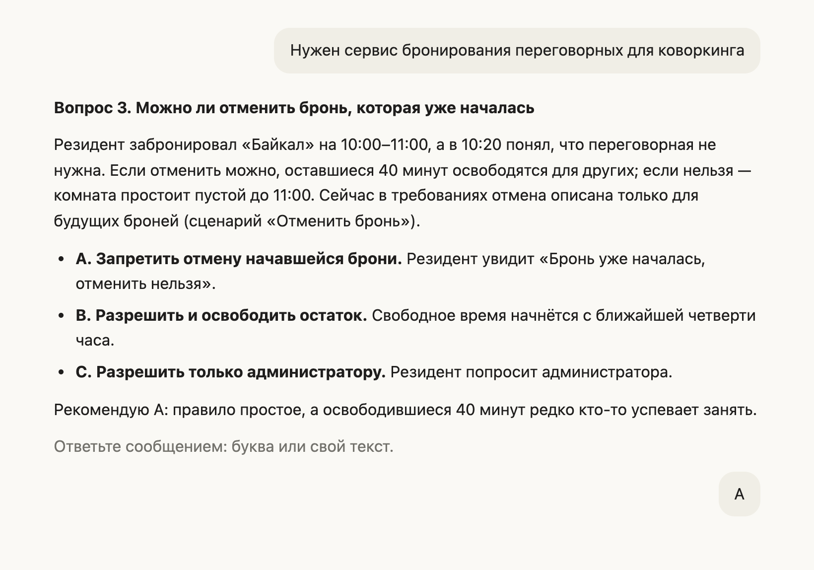
</picture>

**После каждого этапа плагин предлагает проверку и следующий этап, а выбираете вы.** Здесь — момент после
схемы БД: ревью документа, переход к контракту API или остановка.

<picture>
  <source media="(prefers-color-scheme: dark)" srcset="images/dialog-next-stage-dark.png">
  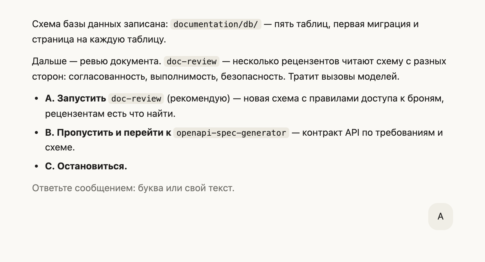
</picture>

**Макеты в Figma** плагин рисует по сценариям требований — каждый экран со всеми состояниями: загрузка,
пустой список, ошибка, открытые окна. Экран, прошедший проверку полноты, получает статус «готово к
разработке». На снимке — макеты другого проекта, реестра ИИ-инициатив:

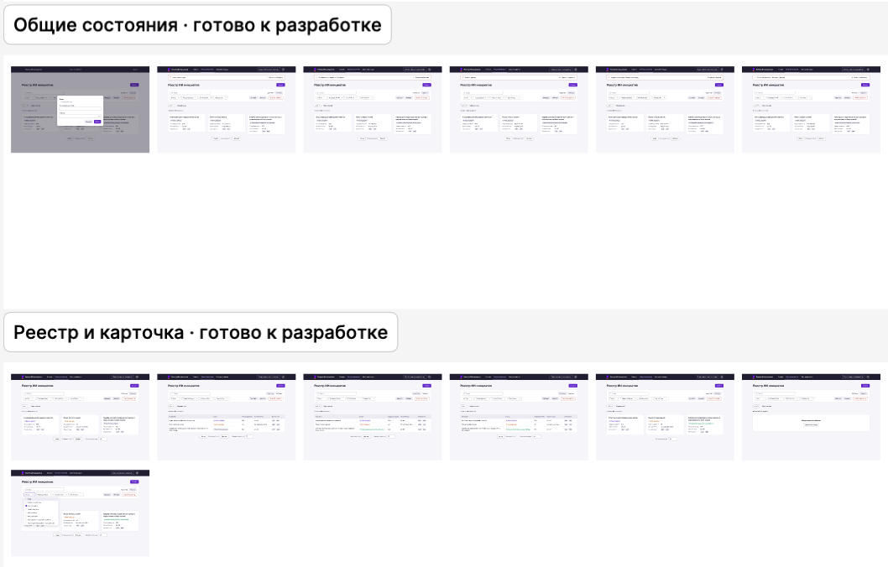

**Документы собираются в сайт** с меню, поиском и ссылками: номер требования ведёт туда, где оно записано.

Требования — сценарий «Отменить бронь» с исключениями и критериями приёмки:

<picture>
  <source media="(prefers-color-scheme: dark)" srcset="images/doc-srs-dark.png">
  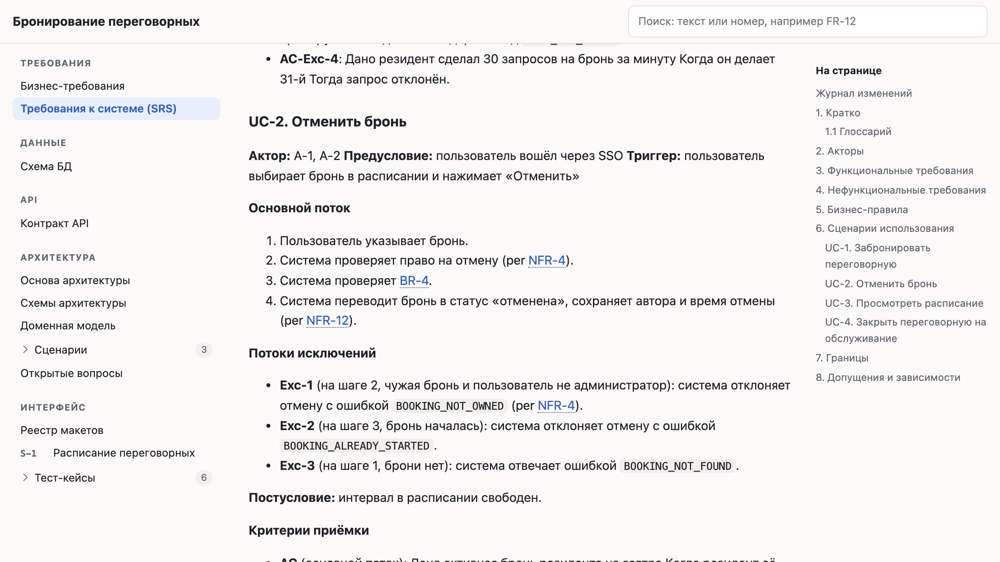
</picture>

Схема базы данных:

<picture>
  <source media="(prefers-color-scheme: dark)" srcset="images/doc-db-dark.png">
  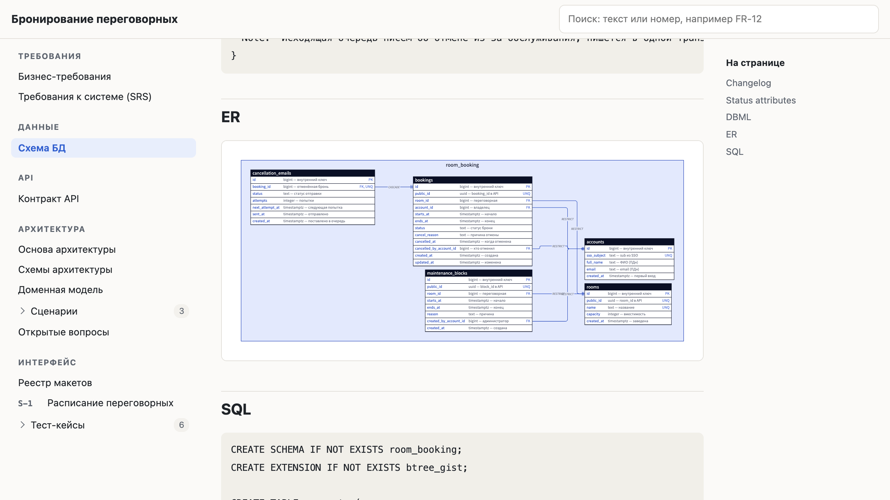
</picture>

Контракт API:

<picture>
  <source media="(prefers-color-scheme: dark)" srcset="images/doc-api-dark.png">
  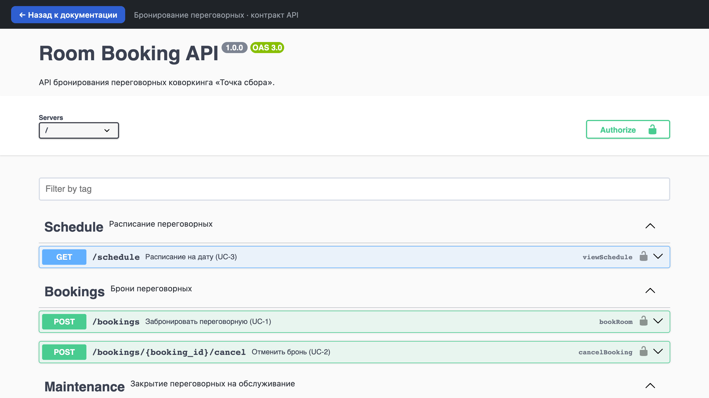
</picture>

Схемы архитектуры:

<picture>
  <source media="(prefers-color-scheme: dark)" srcset="images/doc-architecture-dark.png">
  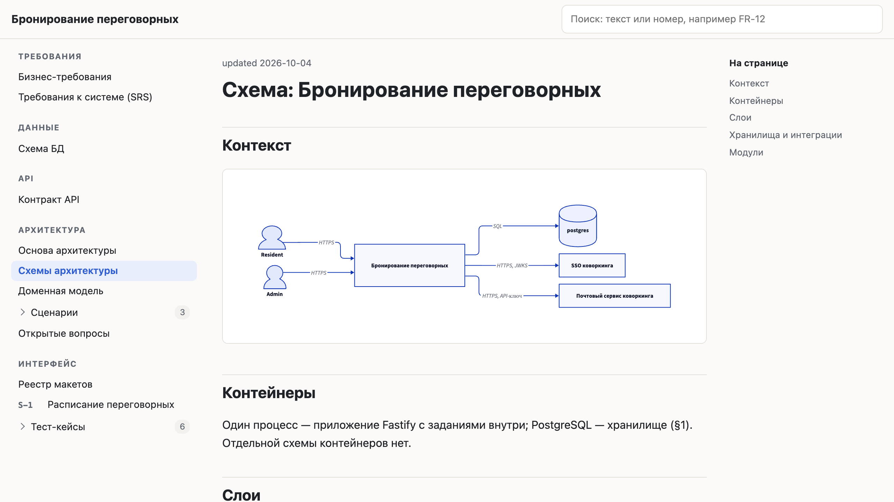
</picture>

ТЗ на экран — состояния экрана расписания:

<picture>
  <source media="(prefers-color-scheme: dark)" srcset="images/doc-screen-dark.png">
  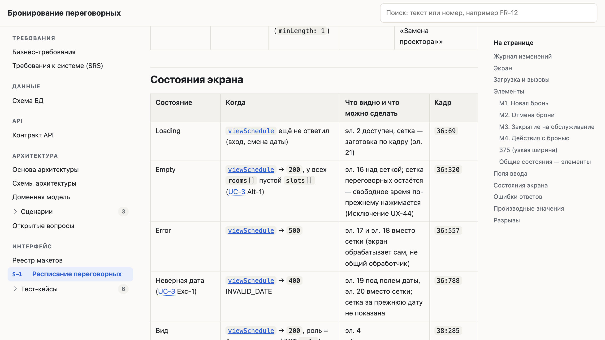
</picture>

Тест-кейс:

<picture>
  <source media="(prefers-color-scheme: dark)" srcset="images/doc-test-case-dark.png">
  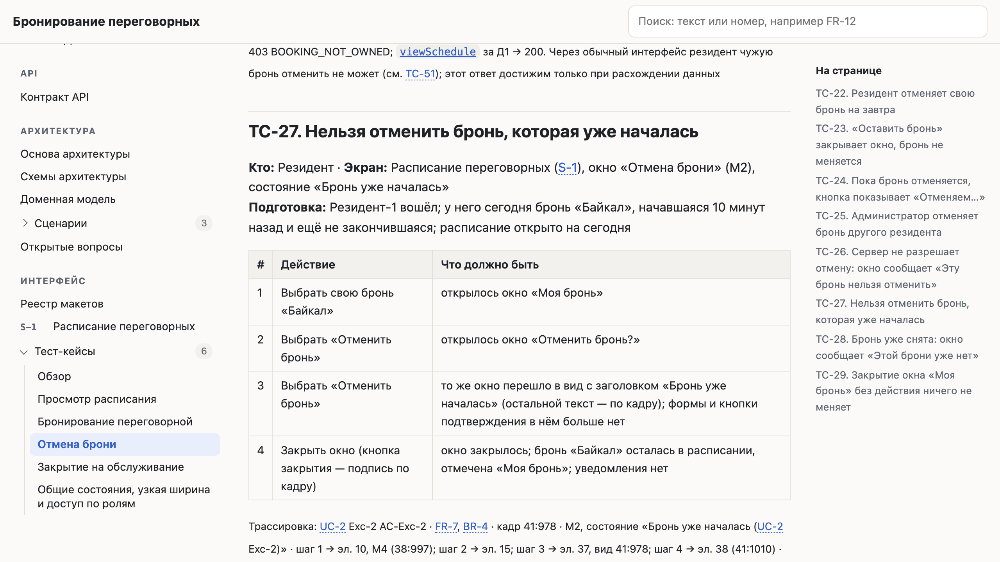
</picture>

**Пока пишется код, видно, как идёт работа** — страница прогресса обновляется сама:

<picture>
  <source media="(prefers-color-scheme: dark)" srcset="images/progress-plan-dark.png">
  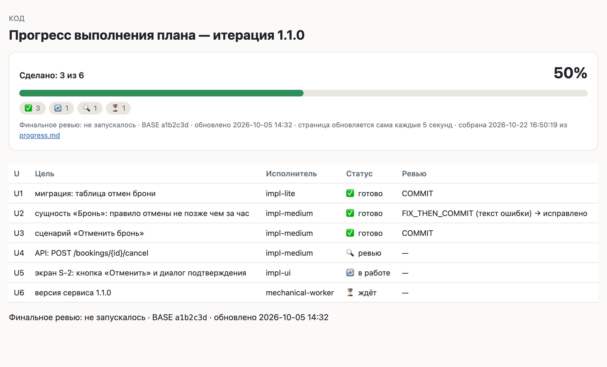
</picture>

**UI-тестирование** — прогон тест-кейсов на запущенном приложении:

<picture>
  <source media="(prefers-color-scheme: dark)" srcset="images/progress-ui-tests-dark.png">
  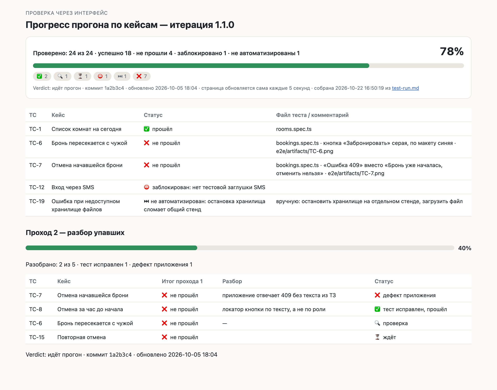
</picture>

</details><!-- /раздел -->

---

<a id="как-устроен-процесс"></a>
<details>
<summary><h2>Как устроен процесс</h2></summary>

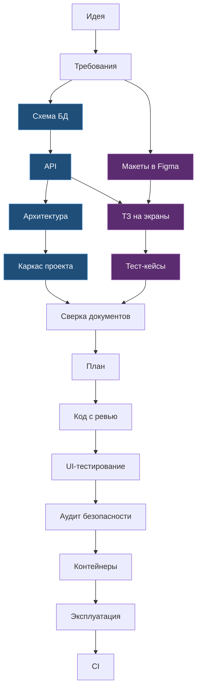

Синим — этапы бэкенда, фиолетовым — этапы дизайна.

| Этап | Что получается | Что делаете вы |
|---|---|---|
| Идея | бизнес-требования: цель, пользователи, границы | отвечаете на вопросы |
| Требования | SRS: требования, сценарии, правила, критерии приёмки | отвечаете, принимаете |
| Схема БД | таблицы, первая миграция, документ по каждой таблице с полями и связями | смотрите, задаёте вопросы |
| API | контракт API | — |
| Архитектура | основа, доменная модель, сценарии | выбираете стек из предложенных вариантов |
| Каркас проекта | пустой запускаемый проект с линтерами (программами, которые проверяют код по правилам) и проверками качества, карта проекта | — |
| Макеты в Figma | 2–3 визуальных направления образцами, экраны в выбранном; перекраска готовых | даёте ссылку на файл Figma (или плагин создаёт его сам), выбираете направление, смотрите макеты |
| ТЗ на экраны | ТЗ на фронтенд по каждому экрану | — |
| Тест-кейсы | пользовательские сценарии проверки, файл на раздел | — |
| Сверка документов | отчёт, согласованы ли все документы | решаете спорные места |
| План | работа, разбитая на небольшие задачи | подтверждаете номер версии, если он изменился |
| Код с ревью | код по плану и страница прогресса | следите за прогрессом |
| UI-тестирование | тест-кейсы прогнаны в браузере, отчёт о дефектах | следите за прогрессом прогона, отвечаете на вопросы о пробелах в ТЗ |
| Аудит безопасности | проверка всего приложения раз за итерацию (проход по этапам ради одной версии): матрица доступа и находки | решаете по каждой серьёзной находке: исправить, принять риск или отложить |
| Контейнеры | образы, docker-compose, архив образов и инструкция по развёртыванию | — |
| Эксплуатация | что система записывает и где это смотреть; запросы проверены на стенде — приложении, запущенном на вашем компьютере для проверок | смотрите пробелы: что видно только SQL-запросом |
| CI | проверки на каждый push (GitHub Actions; по запросу GitLab CI или CircleCI) | — |

«—» значит, что участвовать не нужно; если понадобится решение, плагин спросит.

Плагин пропускает этапы, которые проекту не нужны:

- нет интерфейса — этапы дизайна и UI-тестирование;
- нет базы данных — схему БД;
- нет HTTP-API — этап API.

Что и почему пропущено, он скажет сам.

### Итерация

Итерация — один проход по этапам ради одной версии сервиса. У нового проекта первая версия `0.1.0`; у
доработки плагин предлагает следующий номер по тому, что меняется, и спрашивает. Рабочие файлы итерации
лежат в `documentation/plans/<версия>/` и в git не попадают.

Вся работа итерации идёт в одной ветке `iteration/<версия>`, поэтому в `main` всегда лежит последняя
законченная версия:

- плагин создаёт ветку от `main` в начале итерации, а перед этим подтягивает `main` с GitHub (`origin`);
- если ветка прошлой итерации ещё не слита в `main`, плагин предупредит и спросит, начинать ли без неё;
- все этапы делают коммиты в ветку итерации (коммит — сохранённый в git шаг изменений); в `main` за итерацию
  не попадает ничего;
- на GitHub отправляется только эта ветка вместе с меткой версии: команду
  `git push origin iteration/<версия> v<версия>` даёт плагин, запускаете её вы, и вы же сливаете ветку в
  `main`.

Закрывают итерацию итог `summary.md` и метка `v<версия>` в git — см. «Конец итерации» ниже.

### Порядок веток и кто ведёт дизайн

После требований работа делится на две ветки: бэкенд (схема БД → API → архитектура → каркас) и дизайн
(макеты → ТЗ на экраны → тест-кейсы). Ветки сходятся на сверке документов, а ТЗ на экраны в любом случае
ждут контракт API. Плагин спросит, в каком порядке идти:

- обе ветки параллельно;
- одна за другой, в любом порядке;
- только одна из них;
- или остановиться.

Если у продукта есть экраны, плагин один раз за итерацию спросит, кто ведёт дизайн. Его ведёт либо сам
плагин в этой сессии, либо отдельный дизайнер, который работает с плагином на своём компьютере в той же ветке
итерации. Отдать другим людям можно и остальные этапы — см. «Работа вместе с другими людьми» ниже.

Макеты начинаются одним из трёх способов:

- кадры (экраны в файле Figma) уже нарисовал дизайнер — плагин присваивает экранам номера S-n, составляет
  реестр макетов (список кадров с номерами экранов) и ищет пробелы: не нарисованные сценарии и состояния;
- вы даёте ссылку на файл Figma, где рисовать, — плагин рисует экраны по сценариям требований;
- файла нет — плагин сам создаёт его в вашем Figma и рисует в нём.

### Работа вместе с другими людьми

Каждый документ плагин коммитит сразу, как только он написан, не дожидаясь конца этапа. Если у проекта есть
репозиторий на GitHub, после такого коммита плагин даёт команду, чтобы его отправить. Поэтому работу может
подхватить любой: забрать ветку итерации и вызвать `/dev-pipeline:continue`. Плагин по git поймёт:

- какие документы готовы;
- какой этап не закончен;
- что делать дальше.

Номер версии он возьмёт из имени ветки и спрашивать не будет.

Так любой этап до сверки документов можно отдать другому человеку. Например:

- дизайнер после требований рисует макеты;
- аналитик в это время пишет схему БД, API и архитектуру, а когда макеты появятся в ветке, забирает их и пишет
  ТЗ на экраны;
- вы вызываете `/dev-pipeline:continue`, и плагин предлагает сверку документов, а за ней план и выполнение.

Все работают в одной ветке итерации, каждый в своих документах, поэтому изменения не пересекаются: перед
отправкой своих коммитов достаточно забрать чужие (`git pull --rebase`). Если документа, который нужен этапу,
в ветке ещё нет, плагин скажет, чего не хватает и от кого, и подождёт. Текст для передачи работы плагин пишет
сам: что склонировать, на какую ветку переключиться и какую команду вызвать.

Сверка документов, план и всё, что идёт после, выполняются на одном компьютере: план и отчёты прогона лежат в
`documentation/plans/`, а эта папка в git не попадает.

### Проверки между этапами

Каждый этап опирается на результат предыдущего: код пишется по плану, план — по документам, документы — по
требованиям. Пробел, пропущенный в требованиях, потом обойдётся переделкой кода. Поэтому после этапов
плагин проверяет их результат, прежде чем идти дальше. Проверок пять:

- **Допрос** (`grill-me`) — плагин задаёт неудобные вопросы по документу, чтобы не осталось молчаливых
  допущений. На каждый вопрос отвечаете вы. Идёт после идеи и после требований. На первой версии его лучше
  не пропускать.
- **Ревью документа** (`doc-review`) — несколько рецензентов ищут пробелы, каждый со своей стороны: от логики
  до безопасности. Очевидные правки плагин вносит сам и перечисляет в отчёте («Внесённые правки»). По
  остальным замечаниям он предлагает на выбор:
  - разобрать по одному — решение по каждому ваше;
  - принять правки, которые рекомендовали рецензенты;
  - отложить все — они уйдут в список открытых вопросов рядом с документом;
  - или только отчёт, без правок.

  После правок плагин спрашивает, проверить ли ещё раз; кругов будет столько, сколько понадобится. Идёт
  после:
  - требований;
  - схемы БД;
  - API;
  - каждого документа архитектуры;
  - ТЗ на экраны.
- **Сверка документов** (`docs-consistency`) — отдельный этап перед планом: плагин читает все документы вместе
  и проверяет, что у каждого требования есть место в документах, а одно и то же везде называется одинаково.
- **Ревью плана** (`plan-review`) проверяет, что:
  - задачи действительно маленькие;
  - порядок верный;
  - каждый критерий приёмки чем-то покрыт.

  Замечания к плану плагин исправляет сам и проверяет снова, пока план не пройдёт.
- **Ревью кода** (`code-review-unit`, `code-review-full`) — проверяет задачи по ходу выполнения плана и весь
  результат в конце. Как плагин проверяет задачу, зависит от её сложности — см. «Выполнение плана» ниже.

Допрос, ревью документа и сверку плагин сначала предлагает, а вы выбираете:

- запустить;
- пропустить;
- или остановиться.

После требований это два отдельных вопроса: сначала о допросе, потом о ревью.

Ревью плана и ревью кода идут сами: к этому моменту продуктовые решения уже приняты в документах, и
найденное плагин исправляет сам.

Замечание, которое идёт против уже записанного решения (например, в требованиях сказано, что лимита запросов
с одного адреса нет), плагин сам не исправляет — ни в ревью, ни в аудите. Он показывает это решение и
спрашивает, менять ли его.

Как идёт проверка документа:

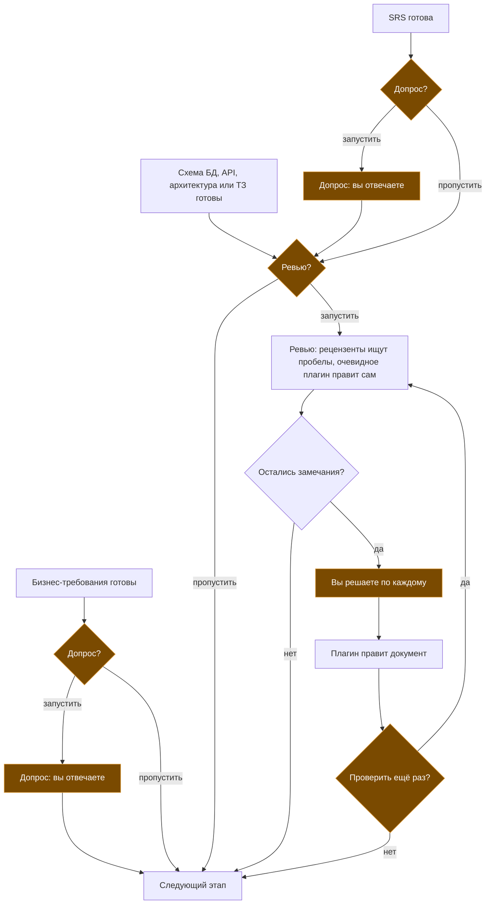

Коричневым — шаги, где решаете вы. На каждом вопросе можно и остановиться: плагин подождёт вашего слова.

Пропуск проверки — нормальный выбор для маленького изменения; плагин сам порекомендует, когда можно
пропустить.

**Круги исправлений.** Если проверка что-то нашла, плагин исправляет и проверяет снова, пока проверка не
пройдёт; заранее заданного числа кругов нет. Замечания делятся по важности от P0 (самое серьёзное) до P3.
Новый круг запускают только блокирующие замечания — P0 и P1, без исправления которых идти дальше нельзя.
Мелкие (P2, P3) уходят в отчёт. Если замечание осталось после исправления, за него берётся исполнитель
следующего уровня (исполнитель — отдельная копия модели, которой плагин отдаёт работу). В файле прогресса
видно, как идут круги: «Круг 3: закрыто 2, осталось 1».

**Когда плагин остановится.** Всё остальное время он работает без вопросов, а остановится и спросит вас,
только когда:

- в документах не хватает решения, и нужно ваше;
- ревью нашло ошибку в проектных документах, а не в коде;
- круги перестали давать результат:
  - вернулось уже исправленное замечание;
  - круг ничего не закрыл;
  - не справился исполнитель последнего уровня.

Тогда плагин напишет в чат:

- что мешает;
- что уже пробовали;
- что вы можете решить.

Ваш ответ плагин сам вносит в документы и коммитит, прежде чем продолжить, — см. «Решение поменялось по ходу
работы» ниже.

### Решение поменялось по ходу работы

Бывает, что решение меняется уже после того, как документ с ним написан:
- вы ответили на остановку при выполнении плана;
- передумали посреди работы («давай по-другому»);
- при просмотре макетов сказали «убери это поле»;
- UI-тестирование показало, что неверно ТЗ, а не код;
- оказалось, что библиотека не умеет так, как записано.

Напоминать про документацию не нужно — плагин сам:

1. записывает изменение в раздел «Изменённые решения» — в отчёте и файле прогресса;
2. находит документ, которому решение принадлежит (требования, API, схема БД, архитектура, ТЗ на экран,
   тест-кейсы), и все документы, которые его повторяют, и правит их на месте;
3. сразу коммитит эти правки отдельным коммитом `docs: решение изменено — …`, **не меняя версию**:
   номер версии и строки журнала появятся при следующей простановке версий, и туда попадут все такие
   изменения;
4. продолжает работу уже по новому тексту. Код, который успели написать по старому решению, плагин
   переделывает отдельным коммитом, а финальное ревью проверяет, что ни одно решение не осталось только в
   коде.

Если правка требует нового проектирования (например, меняется весь ход сценария), плагин остановится и
предложит запустить нужный этап.

### Исполнители и сложность

Большую часть работы плагин отдаёт агентам-исполнителям — отдельным копиям модели, у каждой свои указания.
Модель подбирается под работу: где решать почти нечего, работает модель попроще и подешевле, где ошибка стоит
дорого, — самая сильная. На трёх этапах плагин для этого сначала оценивает сложность работы, на остальных
исполнитель один.

Пять этапов плагин ведёт сам, в вашей сессии и на её модели, без отдельного исполнителя:

- идея (`brainstorm`);
- каркас проекта (`repo-scaffold`);
- контейнеры (`deploy-topology`);
- эксплуатационная документация (`operations-doc`);
- CI (`ci-pipeline`).

Рядом с моделью указано, сколько она думает, прежде чем ответить: low — меньше всего, затем medium и high,
xhigh — дольше всего.

| Этап | Как выбирается исполнитель | Модель |
|---|---|---|
| Требования | один исполнитель | Sonnet, high |
| Схема БД, API, архитектура | по сложности документа | низкая — Sonnet, high<br>средняя — Opus, high<br>высокая — Opus, xhigh |
| Макеты в Figma | по виду работы | новые экраны, редизайн, образцы направлений — Opus, high<br>правки и перекраска готовых экранов — Sonnet, medium |
| ТЗ на экраны | один исполнитель | Sonnet, high |
| Тест-кейсы | один исполнитель | Sonnet, medium |
| Сверка документов | один исполнитель | Sonnet, high |
| План | по сложности плана | низкая — Sonnet, high<br>средняя — Opus, high<br>высокая — Opus, xhigh |
| Код с ревью | по сложности каждой задачи | см. «Задачи кода» ниже |
| UI-тестирование | один исполнитель | Sonnet, high |
| Аудит безопасности | один исполнитель | Opus, high |
| Аудит кода (`upgrade-code`) | исполнитель на каждый модуль и один на документы | Opus, high |

Решения в требованиях, документах и плане принимает исполнитель этапа, а в файл их печатает отдельный —
Sonnet, low: длинный текст по готовым решениям не требует долгих рассуждений.

Проверки тоже распределены по моделям:

- ревью документа:
  - согласованность и выполнимость — Sonnet, medium;
  - интерфейс и объём работы — Sonnet, high;
  - замысел, безопасность и попытка опровергнуть документ — Opus, high;
- ревью плана:
  - структура — Sonnet, medium;
  - суждение о задачах — Opus, xhigh;
- ревью кода:
  - каждой задачи — по её сложности (ниже);
  - итоговое ревью всего результата — Opus, high.

**Что такое сложность.** Это не объём и не важность работы, а то, сколько решений остаётся исполнителю.
Длинный документ о простом CRUD — низкая сложность; короткий, где нужно решить, кто к чему получает доступ, —
высокая.

**Документы и план:**

- низкая — одна таблица, одна операция или простой CRUD, где решать нечего;
- средняя — обычная работа одной части системы, или документу предстоит решить вопрос доступа, денег или
  секретов (паролей, ключей, токенов);
- высокая — такой вопрос вместе с переделкой нескольких разделов, или большая связанная работа: много
  сценариев, таблиц и операций со своими правилами.

**Задачи кода.** Каждой задаче плана плагин ставит одну из четырёх сложностей:

| Сложность | Что это за задача | Исполнитель | Ревью задачи |
|---|---|---|---|
| Механическая | одна повторяемая правка: переименование, перенос, значение настройки, перегенерация — сколько бы файлов она ни задела | Haiku, low | отдельного нет: изменения смотрит сам плагин |
| Низкая | всё решено в документах, а в проекте есть похожий код: перенести решение в код | Sonnet, medium | одно ревью на пачку низких задач — Opus, high |
| Средняя | часть решений остаётся исполнителю или ошибка стоит дорого: принять оставшиеся решения и доказать их тестами | Sonnet, high | ревью задачи — Opus, high |
| Высокая | решение открыто, задача задевает несколько частей проекта или ошибку не исправить: спроектировать недостающее в заданных границах и проверить на крайних случаях | Sonnet, high | строгое ревью — Opus, xhigh — и отдельная проверка рисков |

Экраны по макетам при любой сложности пишет отдельный исполнитель для интерфейса — Sonnet, high; ревью — по
сложности задачи.

Сложность задачи плагин определяет по шести признакам:

1. осталось ли что-то решать;
2. насколько полно задача описана в документах;
3. сколько частей проекта она задевает;
4. есть ли в проекте похожий код, на который можно опереться;
5. чем обойдётся ошибка;
6. как доказать результат: прямой проверкой или только с помощью
   - подмены времени;
   - заглушек вместо настоящих частей;
   - одновременных запросов;
   - сквозного прогона.

Правила:

- задача не ниже средней, если ошибка в ней касается:
  - входа;
  - прав доступа;
  - денег;
  - миграций на существующих данных;
  - секретов;
  - или внешнего контракта (API, которым пользуются другие системы);
- такая задача — высокая, если в ней ещё осталось решение, она описана не полностью или её доказывает только
  тест одновременных запросов (например, деньги списываются под блокировкой строки);
- высокая и без риска:
  - три дорогих признака сразу;
  - или открытое решение (признак 1) вместе с признаком 3 или 6;
- объём — не сложность: тридцать файлов одной правки — механическая задача.

**Если исполнитель не справился**, плагин поднимает задачу на уровень выше вместе с отчётом прошлой попытки:
механическая → низкая → средняя → высокая → последний уровень (Sonnet, high).

- Модель меняется только на первом шаге, с механического уровня на низкий. <!-- claude-only -->От низкого к
  среднему растёт то, сколько модель думает (medium → high). Дальше следующий уровень помогает не моделью
  посильнее, а своими указаниями и отчётом прошлой попытки.<!-- /claude-only --><!-- codex: Выше все уровни
  работают на одной модели с одним усилием: следующий уровень помогает своими указаниями и отчётом прошлой
  попытки. -->
- На последнем уровне плагин повторяет задачу, пока попытки что-то дают.
- Если оказалось, что неверен сам подход, плагин запускает две попытки с двумя разными подходами от одного
  коммита, а победителя выбирают тесты.
- Когда и это не помогло, плагин останавливается и спрашивает вас.

Исполнитель экранов на эту лестницу не поднимается: если ему трудно, плагин запускает его снова с отчётом
прошлой попытки, пока попытки что-то дают.

<!-- models -->
<!-- /models -->

### Выполнение плана

Код пишет плагин (`work`) по готовому плану, задача за задачей.

Путь одной задачи:

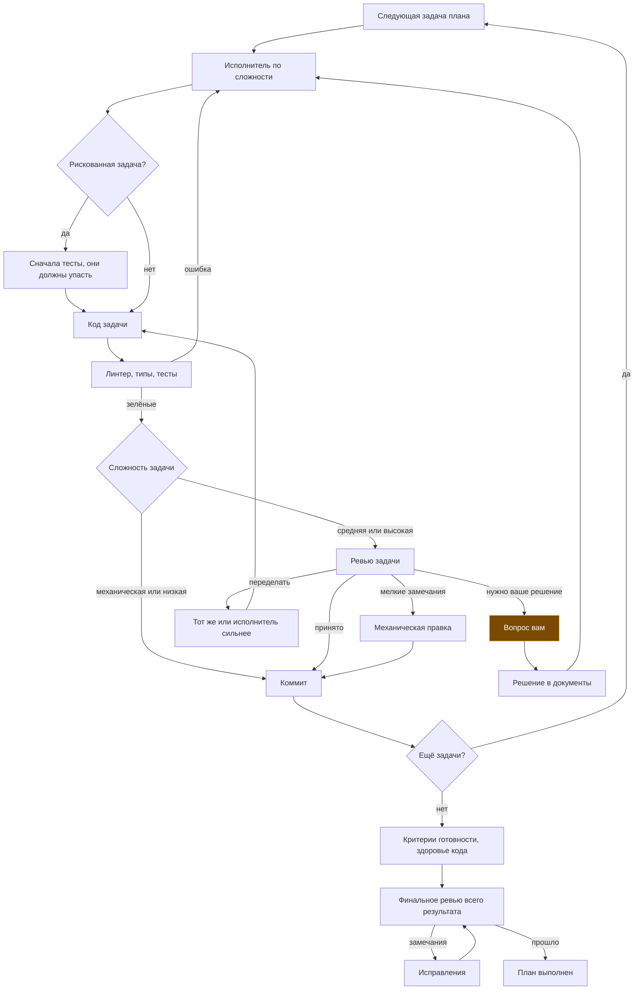

Коричневым — шаг, где решаете вы.

Ревью задачи зависит от её сложности:

- у механической задачи отдельного ревью нет — изменения смотрит сам плагин;
- низкие задачи плагин коммитит сразу, а ревью проходит пачка таких задач;
- средние и высокие задачи проходят ревью каждая, перед коммитом.

Экран — обычно одна задача. Большой экран (больше ~40 элементов или ТЗ больше ~100 КБ) план делит на задачи по
частям: форма, блок, диалог. Каждый исполнитель получает только строки своих элементов, их состояния и ошибки,
а последняя часть проверяет экран целиком. Само ТЗ остаётся одним файлом.

**Выполнение идёт само:** ревью, исправления и повторные проверки идут без вопросов к вам. Закончив задачу,
плагин сразу берёт следующую и вашего ответа не ждёт, поэтому выполнение плана можно оставить на ночь.
Остановится он только в случаях, перечисленных в «Проверках между этапами» (раздел
[Как устроен процесс](#как-устроен-процесс)). Случайное или короткое сообщение («ну?», «ты тут?») выполнение
не останавливает: плагин ответит одной строкой со счётом и ссылкой на прогресс и продолжит.

**Проверить, а не спросить.** Если ответ можно узнать, просто что-то запустив (например, какой порт у стенда),
плагин проверяет сам и пишет «решил по проверке: … → …». Спрашивает он только о решениях, которые документы
оставили открытыми.

#### Качество кода

Код пишут исполнители, и качество держат не на словах:

- **Правила языка.** Каждый исполнитель получает правила своего языка и библиотек — `typescript`, `react`,
  `python` и скиллы библиотек. Плагин подбирает их по стеку проекта и файлам задачи.
- **Писать как можно меньше:**
  - сначала готовое из проекта, затем стандартная библиотека, затем уже установленные пакеты;
  - никаких абстракций и настроек «про запас»;
  - удалить лучше, чем добавить.
- **Автоматические проверки** — после каждой задачи и в CI на каждый push; ошибка возвращает задачу
  исполнителю:
  - линтер с порогами сложности и размера функций и файлов;
  - запрет пустых `catch` и промисов, результат которых никто не проверяет;
  - проверка типов вместе с тестами;
  - границы слоёв;
  - мёртвый код и дубли.
- **Ревью задачи** смотрит то, чего машина не видит: правило, скопированное в другой слой вместо того, чтобы
  взять его из одного места, и ошибки, которые перехватываются и пропадают без записи в лог. У сложных задач
  отдельный проход по рискам видит только изменения, контракт и тесты, без рассказа исполнителя о своей работе.
- **Порог качества ужесточается молча, а ослабляется только явно.** Поднятый порог, отключённое правило или
  подавление без причины ревью считает замечанием, если задача этого не предусматривала. У каждого исключения
  есть владелец и срок.
- **Тесты:**
  - правила, которые должны держаться на любых входах, тесты проверяют на сотнях случайных значений;
  - тесты задач с бизнес-правилом и задач высокой сложности проходят мутационную проверку: программа нарочно
    ломает код и смотрит, заметят ли тесты. Она идёт один раз, в конце выполнения плана, только по строкам этих
    правил. Перед первой такой проверкой плагин объясняет, что значат «убит», «выжил» и «эквивалентный», и
    говорит, сколько она займёт; дольше 30 минут — спросит;
  - защиту от двойного действия доказывает тест двух одновременных запросов к настоящей базе.
- **Сначала тесты** — для задач со входом, правами, деньгами, миграциями на существующих данных или
  секретами и для всех задач высшей сложности. Исполнитель сначала пишет только тесты, плагин проверяет, что
  они падают по нужной причине, и только потом исполнитель пишет код.
- **Контекст сессии не раздувается** — в `work` и на всех этапах документов:
  - исполнители и ревьюеры возвращают короткий отчёт (около 2000 символов), подробности пишут в файл;
  - всё, что требует решения, обязано быть в коротком отчёте: ревьюер читает подробный файл и возвращает задачу,
    если там спрятан пропущенный шаг или обход, а скрипт ищет в подробностях тревожные слова;
  - тесты, линтер и проверка типов запускаются через скрипт: полный вывод в файл, в контекст — итог с числами и
    упавшими тестами, с тревогой, если тестов стало меньше или пропущенных больше;
  - после каждой задачи, каждого готового экрана, раздела тест-кейсов или области аудита и при переходе между
    этапами плагин проверяет размер контекста и, если он больше ~300 тыс. токенов, передаёт работу новой сессии;
  - правки документов по одному изменённому решению печатаются одним запуском, а не по запуску на документ.
- **Порядок в общих ресурсах:**
  - тесты работают со своей базой и не могут попасть в базу стенда — без отдельного адреса тестовой базы они
    падают, а не берут адрес по умолчанию;
  - на общей тестовой базе идёт один прогон тестов за раз;
  - коммит делается только после прочитанного итога проверок;
  - правки вне задач (стенд, контракт, исправления по ревью) проходят те же проверки, что задачи;
  - если работа встала из-за окружения (прокси, сеть, порт), причина сначала проверяется живой командой.
- **Здоровье кода в конце выполнения плана:** отдельный коммит убирает то, что разрослось за это время, а
  итоговое ревью проверяет, что код не стал хуже.
- **Безопасность в CI.** Отдельная задача CI на каждом push:
  - ищет ключи и пароли во всей истории коммитов;
  - ищет опасные шаблоны кода — SQL, собранный склейкой строк, текст пользователя, вставленный как HTML
    (`semgrep`);
  - проверяет зависимости на известные уязвимости.

  Сначала она только предупреждает, обязательной её делают разработчики проекта, когда готовы.

#### Остановка и продолжение

Выполнение плана можно остановить и продолжить без потерь:

- на «стоп», «подожди» или «остановись» плагин останавливается на безопасной границе: сохраняет
  незаконченную работу и останавливает фоновые процессы, которые следят за стендом и тестами;
- если работа прервалась (обрыв связи или сжатие контекста — Claude Code сокращает длинную переписку до
  сводки), любое ваше сообщение возобновит её с того места, где она остановилась;
- новая сессия ничего сделанного не переделывает и не повторяет уже провалившиеся попытки.

**Несколько итераций без вас.** Если попросить сделать несколько итераций подряд или поработать без вас, плагин
до старта один раз соберёт ответы на всё, о чём будет спрашивать по ходу:

- вопросы о поведении из ревью;
- проверки этапов;
- аудит безопасности и UI-тестирование;
- объём e2e;
- слияние и теги;
- обновления зависимостей;
- что останавливает всю цепочку.

Сессия, которая ведёт итерацию, сообщает о её закрытии. Ожидающая сессия проверяет её состояние, а не отвечает по
памяти, и сразу запускает следующую.

**Родительская сессия и подсессии.** <!-- claude-only -->В приложении Claude так работает каждая итерация. Сессия, которую
вы открываете в проекте, — родительская: сама этапы она не ведёт, а открывает на каждый этап подсессию с чистым
контекстом. Подсессии видны под ней в боковой панели, работаете вы прямо в них. Когда этап закрыт и вы выбрали
следующий, подсессия сообщает об этом родителю, и тот открывает следующую. После ТЗ две ветки — дизайн и бэкенд —
могут идти в двух подсессиях одновременно. Если подсессия разрослась посреди этапа, она передаёт работу новой
(«продолжать с U18»). Каждый этап начинается с чистого листа, и правила не теряются при сжатии переписки. В
терминале, где открывать сессии нельзя, этапы идут в одной сессии, а при большом контексте плагин попросит открыть
новую.<!-- /claude-only --><!-- codex: В версии для Codex этапы пока идут в одной сессии; при большом контексте плагин попросит открыть новую. -->

### Стенд для проверок в браузере

Браузерным тестам в `work`, UI-тестированию и проверке запросов эксплуатационной документации нужно запущенное
приложение — стенд. Как его поднять, плагин записывает в сам проект — скилл `.claude/skills/verify/`:

- команда запуска и что значит «готов»;
- вход под каждой ролью;
- тестовые данные;
- подвохи окружения.

Скилл пишет первый этап, которому нужен стенд, дальше плагин сам дополняет его. Так каждая следующая сессия
берёт готовое, а не выясняет заново.

### Прогресс

Каждый долгий этап ведёт файл прогресса со страницей, где видно, как идёт работа. <!-- claude-only -->В
приложении Claude плагин сам открывает эту страницу во встроенном браузере и даёт ссылку на неё в
чат.<!-- /claude-only --><!-- codex: Плагин даёт в чат ссылку на эту страницу — откройте её в браузере. --> Ссылка повторяется вместе со
счётом после каждой задачи — «План: 3 из 6 · progress.html» — и при каждой остановке.

У выполнения плана файл прогресса — `documentation/plans/<версия>/progress.md` рядом с планом. В нём по
каждой задаче:

- что делает;
- какой исполнитель её выполняет;
- статус;
- итог ревью.

Строка меняется сразу, как только меняется статус задачи.

Статусы одни и те же во всех файлах прогресса — у задач, экранов, документов, сканеров, исправлений и
стендов:

| Статус | Значит |
|---|---|
| `⏳ ждёт` | ещё не начато |
| `🔄 в работе` | начато: отдано исполнителю, рисуется, пишется, выполняется, исправляется |
| `🔍 ревью`, `🔍 аудит`, `🔍 разбор`, `🔍 проверка` | сделано, идёт проверка — название говорит, какая |
| `✅ готово` | закончено и принято, полоса прогресса считает эти строки |
| `🔁 возвращено: <что>` | отправлено на доработку после проверки |
| `⛔ остановлено: <причина>` | дальше нельзя без решения или недостающего, или не удалось запустить |
| `⏭ пропущено: <почему>` | не нужно, вне объёма или ушло в отчёт |

После двоеточия этап может уточнить шаг (`🔄 в работе: печать`). Исключение одно — отчёт UI-тестирования:
там таблица — это отчёт о дефектах, и у кейса свои итоги (см. «UI-тестирование» ниже).

У выполнения плана страница прогресса — `progress.html`. На ней:

- полоса прогресса;
- счёт;
- сколько строк в каждом статусе;
- таблица задач.

Страница обновляется сама каждые 5 секунд; <!-- claude-only -->её отдаёт локальный сервер, который виден
только с вашего компьютера. В терминальном Claude Code встроенного браузера нет: там ссылка ведёт на
файл.<!-- /claude-only --><!-- codex: ссылка ведёт на файл страницы в проекте. -->

Так выглядит страница прогресса:

<picture>
  <source media="(prefers-color-scheme: dark)" srcset="images/progress-plan-dark.png">
  
</picture>

Все задачи весят одинаково, процент округляется вниз, поэтому 100% появится только после последней задачи.

Когда в конце выполнения плана идут браузерные тесты (это может занять час и больше), на странице появляется
раздел «e2e»:

- полоса — доля тестов, которые прошли;
- «Проверено: N из M · успешно · не прошли · пропущено»;
- таблица по файлам тестов;
- строка стенда: режим входа, образы, идёт ли прогон.

Раздел обновляется сам по ходу прогона.

### UI-тестирование

Тест-кейсы плагин пишет заранее, вместе с дизайном, а на этапе UI-тестирования прогоняет их на запущенном
приложении. `ui-test-cases` работает в двух режимах:

- **Запись** — после ТЗ на экраны: критерии приёмки из требований становятся пронумерованными кейсами с
  шагами и ожидаемыми текстами.
- **Прогон** — после этапа «Код с ревью»: плагин превращает кейсы в Playwright-тесты и прогоняет их на
  запущенном приложении в два прохода — сначала весь набор, потом разбор упавших. Заодно он сверяет экраны с
  макетами на каждой ширине из реестра макетов: страница не должна прокручиваться вбок (UX-74).

Как идёт прогон:

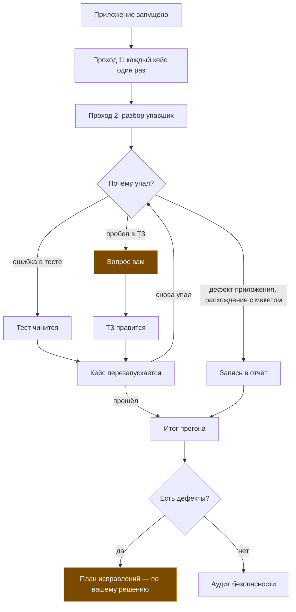

Коричневым — шаги, где решаете вы.

Дефекты приложения и расхождения с макетом плагин сам не исправляет: если вы решите, он допишет задачи на их
исправление в план этой версии (по задаче на дефект или на общую причину) и выполнит их. Пробел в ТЗ — вопрос вам, и ваш ответ — изменённое решение: плагин сразу правит ТЗ на экран
(а если нужно, и требования, API, тест-кейсы), коммитит правку и до итога перезапускает эти кейсы.

<details>
<summary><b>Как выглядит тест-кейс</b></summary>

Кейс читает человек (тестировщик, аналитик, вы), а исполнитель прогона превращает его в автотест. Поэтому у
кейса два слоя: тело — человеческим языком, всё техническое — в строке «Трассировка» под ним.

<picture>
  <source media="(prefers-color-scheme: dark)" srcset="images/doc-test-case-dark.png">
  
</picture>

Шаги — действия по подписям, которые видны на экране; ожидаемое — то, что видно глазами, с точными
текстами и настоящими датами. Кадры, номера элементов, вызовы API и коды ответов — только в трассировке:
по ней исполнитель находит элементы на странице, подменяет ответы сервера и сверяет экран с макетом.

Если ТЗ на экран, макет или API поменялись, плагин перепроверяет ссылки в трассировке кейсов. Что можно, он
исправляет сам, а к вам попадает только то, чего больше нет (элемент, на который ссылается кейс, удалён).

</details>

<details>
<summary><b>Как идёт прогон</b></summary>

Перед стартом плагин даёт ссылку на страницу `test-run.html`, перед вторым проходом — ещё раз.

1. **Проход 1 — весь набор до 100%.** Каждый кейс плагин пишет и прогоняет один раз: прошёл, не прошёл или
   заблокирован. Тесты в этом проходе плагин не чинит — сначала нужна полная картина. Исключение одно: если
   несколько кейсов подряд падают из-за одной общей части тестов (вход под ролью, подготовка данных), проход
   встаёт на паузу, плагин чинит эту часть и перезапускает эти кейсы. Если кейсы проверяются в нескольких
   режимах (например, два способа входа), каждая пара «кейс × режим» считается отдельно.
2. **Проход 2 — разбор упавших.** Каждый не прошедший кейс плагин разбирает:
   - ошибка в тесте — плагин чинит тест и перезапускает кейс, круг за кругом, пока каждая починка что-то
     меняет;
   - пробел в ТЗ — плагин спрашивает вас и, получив ответ, правит ТЗ и перезапускает кейсы (см. выше); так же
     — дефект, который вы признали ошибкой ТЗ, а не приложения («так и должно быть»);
   - дефект приложения или расхождение с макетом — плагин записывает как есть.

**Главная полоса — доля успешных кейсов**, а не выполненных: полоса «выполнено 94%» при трети упавших
выглядела бы почти готовой. Кейсы, которые нельзя автоматизировать, в процент не входят: успешно 18 из 23 —
это 78%. Полоса растёт в первом проходе и после каждого круга перезапуска, когда исправленные тесты начинают
проходить. Под ней — «Проверено: 24 из 24 · успешно 18 · не прошли 4 · заблокировано 1 · не автоматизированы
1»; «не прошли» — только настоящие падения.

**Перезапуск — со своей полосой.** Пока кейсы перезапускаются, основная полоса стоит на месте, а у
перезапуска свой блок с полосой и итогом.

Итог («Verdict») появляется только после второго прохода:

- `PASS` — все автоматизированные кейсы прошли, сразу или после починки теста;
- `DEFECTS` — остались дефекты приложения, расхождения с макетом или пробелы в ТЗ;
- `BLOCKED` — заблокированные кейсы оставили экран непроверенным.

<picture>
  <source media="(prefers-color-scheme: dark)" srcset="images/progress-ui-tests-dark.png">
  
</picture>

**Статусы кейса.**

- Итог первого прохода:
  - `✅ прошёл`;
  - `❌ не прошёл`;
  - `⛔ заблокирован` (не хватает того, что можно добавить, например тестового входа);
  - или `⏭ не автоматизирован` (автотестом на общем стенде честно не проверить: нужен отказ хранилища,
    перезапуск с другой настройкой — такие кейсы плагин перечисляет под итогом в списке «Проверить вручную» с
    шагами);
- Итог второго прохода:
  - `✅ тест исправлен, прошёл`;
  - `⛔ тест не удалось исправить`;
  - `❌ дефект приложения` (приложение расходится с ТЗ);
  - `🖼 расхождение с макетом` (экран не совпадает с макетом);
  - или `❓ пробел в ТЗ` (ТЗ этого не описывает).

Кейс, прошедший после починки теста, в таблице первого прохода становится
`✅ прошёл после исправления теста`.

**Параллельный прогон.** Тесты, которые делят один стенд, идут по одному. Если компьютер позволяет, плагин
поднимает несколько одинаковых стендов (не больше четырёх) и делит тесты между ними. Если стенд проекта ещё
нельзя копировать, плагин перед прогоном предложит сделать это отдельным коммитом. В отчёте написано, сколько
стендов взято и что ограничило; после прогона плагин их убирает, а чужие окружения (`dev`, `demo`) не трогает.

</details>

### Аудит безопасности

Ревью кода в `work` смотрят только то, что изменил очередной план. Раз за итерацию, перед сборкой релиза,
`security-audit` проверяет приложение целиком. Запустить его можно и в любой момент: «проверь безопасность».

1. **Сканеры по всему коду и всей истории git** (через Docker, ничего не ставится на компьютер):
   - уязвимые версии зависимостей (`osv-scanner`);
   - ключи и пароли в файлах и старых коммитах (`gitleaks`);
   - опасные шаблоны кода по OWASP (`semgrep`).
2. **Матрица доступа** из документов: каждая операция API — кто её может вызывать по требованиям и чьи
   данные она трогает.
3. **Проверка по областям**: исполнитель аудита (Opus, high) проходит каждую операцию от входа запроса до
   базы данных:
   - проверяет ли код права;
   - нельзя ли получить чужие данные, подменив id;
   - проверяет ли код ввод;
   - не уходит ли лишнее в ответе и в ошибках;
   - не сохраняет ли запись поля, которые клиенту задавать нельзя (владелец, роль, статус, цена).

   Отдельно он проверяет настройки всего приложения:
   - сессии, cookie, CORS, лимиты, конфигурацию;
   - хранение паролей и защиту входа и регистрации от подбора;
   - фронтенд: не вставляется ли текст пользователя как HTML, нет ли секретов в коде, который получает
     браузер, не лежит ли токен сессии в `localStorage`.
4. **Перепроверка**: второй проход пытается опровергнуть каждую серьёзную находку и отсеивает ложные
   срабатывания.

Находки делятся по важности:

- P0 — уязвимостью можно воспользоваться снаружи, без особого доступа;
- P1 — пользователь после входа выходит за свою роль, или не выполнено заявленное требование безопасности;
- P2 — защита ослаблена, но само по себе это взлома не даёт.

По каждой находке P0/P1 плагин спросит:

- исправить;
- принять риск — с вашей причиной; риск записывается в архитектуру, в таблицу «Принятые риски», и следующий
  аудит его учитывает;
- или отложить.

Исправления плагин дописывает задачами в план этой версии и выполняет через `work`. После них аудит
перепроверяет исправленное и заново запускает сканеры. Пока открыта находка P0, этап «Контейнеры» не соберёт релиз, если вы не скажете «собирать всё равно».
Сами Docker-образы плагин проверяет сканером `trivy` при сборке релиза. Сканеры качают базы уязвимостей из
интернета; за корпоративным прокси плагин берёт настройки прокси с машины. Если сеть недоступна, плагин
помечает сканер «не запускался: сеть» и продолжает аудит.

**Ключи и пароли в чате.** Плагин никогда не просит прислать ключ, токен или пароль — только спрашивает, какой
сервис и есть ли аккаунт. Если вы всё же вставите такое значение в сообщение, плагин заметит его по виду и не
запишет ни в документы, ни в задания агентам, ни в коммиты:

- вместо значения в проекте будет имя переменной в `.env.example`;
- само значение вы впишете в `.env` сами — этот файл не попадает в git;
- плагин скажет об этом одной строкой и посоветует ключ отозвать и выпустить новый: он уже побывал в переписке.

### Контейнеры и передача в эксплуатацию

Этап «Контейнеры» собирает образы так, чтобы сервис без доработок запускался в Kubernetes и проходил проверку
DevOps перед размещением:

- приложение работает не от root, а под непривилегированным пользователем с числовым идентификатором;
- проверки здоровья раздельные: `/health/live` — процесс жив (базу не трогает), `/health/ready` — сервис готов
  принимать запросы (база доступна, иначе 503);
- метрики для Prometheus — `/metrics`;
- логи — JSON-строками в stdout, у каждого запроса свой `request_id`;
- по сигналу остановки сервис дорабатывает текущие запросы и выходит без потери данных;
- настройки и секреты — только через переменные окружения, в образ ничего не вшито;
- образ собран под `linux/amd64` и проверен сканером уязвимостей.

Тестовый стенд работает с теми же ограничениями, что кластер: файловая система только для чтения, без лишних
привилегий, две учётные записи базы — владелец схемы для миграций и учётная запись приложения только для данных.
Так то, что не пройдёт проверку DevOps, ломается ещё на стенде. На стенде же плагин замеряет, сколько процессора
и памяти занимает сервис, и записывает рекомендованные requests и limits.

**Папка выпуска** `release/<версия>/` — всё, что получает эксплуатация:

- архив образов (в свой registry их загружает эксплуатация);
- `DEPLOY.md` — карточка сервиса, проверки с таймаутами, ресурсы, порты и внешние зависимости, раздел для DBA
  (схемы, учётные записи и их права), логи, метрики, порядок запуска, миграций и остановки;
- `<проект>.env.example` — переменные с пометками «обязательна» и «секрет»;
- `openapi.yaml` — контракт API одним файлом;
- `OPERATIONS.md` — эксплуатационный документ (см. ниже).

Три вещи выбираются для проекта:

- архитектура образа — по умолчанию `linux/amd64`, для кластера на ARM скажите «arm64»;
- образ без оболочки и утилит — плагин спросит один раз, при первой сборке: так требуют строгие платформы, но в
  работающий контейнер тогда не зайти командой `sh`;
- трассировка (OpenTelemetry) — только по вашей просьбе.

### Эксплуатационная документация

`DEPLOY.md` говорит, как систему запустить. Что делать с ней потом, говорит
`documentation/operations/operations.md`:

- где посмотреть:
  - кто отменил бронь;
  - отработала ли ночная очистка;
  - почему не ушло письмо;
- что делать, когда растёт очередь.

Плагин пишет его после сборки образов и кладёт в релиз как `OPERATIONS.md` рядом с `DEPLOY.md`.

<details>
<summary><b>Что внутри документа</b></summary>

Документ один для двух читателей: тех, кто эксплуатирует систему, и разработчиков на дежурстве. В каждой
строке — задача человеческими словами и отдельным столбцом «Где в системе»: таблица, файл, операция API.
Разделы:

- доступы;
- журналы:
  - что в записи;
  - кто пишет;
  - сколько хранится;
  - как посмотреть;
- готовые SQL-запросы только для чтения;
- события в логах с фильтрами;
- проверки и метрики;
- фоновые процессы;
- тревоги;
- типовые операции;
- разбор проблем по симптомам.

Всё плагин берёт из схемы, архитектуры, требований и кода — ничего не придумывает. Если журнал по требованиям
должен видеть администратор, а увидеть его можно только SQL-запросом, документ так и пишет: «только SQL —
экрана нет», и этот пробел попадает в отчёт этапа. Каждый запрос и каждую команду плагин выполняет на тестовом
стенде на настоящих записях. А тест в проекте проверяет все запросы документа на тестовой базе: переименуют
колонку — упадёт сборка, а не дежурный ночью.

**Обязательные журналы.** Журналы, которые система обязана вести по закону, регламенту или требованиям
безопасности (обработка персональных данных, согласия, запросы субъектов, доступ к ПДн, аудит действий), идут
отдельным разделом «Обязательные журналы»:

- основание;
- срок хранения по основанию и в системе;
- кто может смотреть.

Если такой журнал требуется, а в системе его нет, или срок короче положенного, — это первая строка отчёта
этапа.

</details>

### Конец итерации

Когда пройден последний этап итерации (или последний из тех, что вы не пропустили), плагин закрывает её сам:

- переносит в документы то, что ещё записано только в рабочих файлах, и записывает в документы версию;
- пересобирает сайт документации;
- пишет итог версии `plans/<версия>/summary.md` — это и есть закрытие;
- ставит метку `v<версия>` в git — снимок документации и кода; с ним следующая итерация сравнивает,
  что изменилось;
- пишет отчёт для автора плагина (`/dev-pipeline:reflect`, см. ниже);
- даёт команду, чтобы отправить ветку и метку;
- последним вопросом спрашивает, убрать ли рабочие файлы закрытой итерации (см. ниже).

Если вы остановили работу раньше последнего этапа, а релиз версии всё равно нужен, напишите «итог» — плагин
закроет итерацию так же.

**Уборка.** После итога плагин удаляет рабочие файлы закрытой итерации, чтобы не копить архив:

- план;
- ревью плана;
- файлы прогресса;
- отчёты этапов и аудита;
- служебные файлы.

Остаётся только `summary.md` — цифры итерации. Документы проекта (требования, API, архитектура, ТЗ,
тест-кейсы) плагин не трогает. Всё, что записано только в рабочих файлах, к этому моменту уже в документах:
принятый риск попадает в архитектуру сразу, как вы его приняли, а остальное плагин переносит до метки версии.

Папка `plans/` не хранится в git, удалённое не вернуть, поэтому плагин показывает список с размерами и
спрашивает один раз. Лишние файлы в `documentation/` — которых нет в реестре и на которые никто не ссылается —
он только показывает и спрашивает по каждому.

### Отчёт для автора плагина

В конце каждой итерации плагин без вопроса запускает `reflect`: перечитывает сессии проекта и записывает, где
сработал не так сам плагин, а не проект, — с вашими словами как доказательством и предложением, что поменять.
Отчёт лежит вне репозитория, в `~/.claude/dev-pipeline-feedback/<проект>.md`; плагин сам себя по нему не
правит. Кроме переписки, `reflect` просматривает ошибки команд — и в самой сессии, и у всех агентов, которых она
запускала: неверные флаги, пути, отказы в правах, слишком большие файлы. Похожие ошибки собираются в группы с
числом повторов, и находкой становится только то, к чему привёл текст плагина; упавшие тесты проекта находками не
считаются. Этот файл можно отправить автору через issues репозитория — см.
[Если что-то пошло не так](#если-что-то-пошло-не-так). Запустить вручную: `/dev-pipeline:reflect` или «разбери
сессии для плагина».

**Расход.** В тот же отчёт записывается расход итерации по журналам <!-- claude-only -->Claude Code<!-- /claude-only --><!-- codex: Codex (счётчики токенов в файлах сессий) -->: сколько потратили сама
сессия, исполнители, ревью кода, писатели и проверяющие документов — по каждому агенту, с пиком контекста и
моделью. Отдельно — «Принятие задач»: сколько задач прошли ревью с первого раза, сколько возвращались и сколько
стоит одна принятая задача; эти цифры сохраняются вне проекта до очистки рабочих файлов, поэтому их видно и в
позднем разборе. Ниже — подсказки, на что посмотреть: например, много мелких задач, у которых почти
весь расход ушёл на то, чтобы агент вошёл в задачу, или меньше половины задач, прошедших ревью с первого раза. На вопрос «сколько стоила итерация» плагин ответит этими же цифрами, ничего не
записывая. Чтобы проверить, стал ли плагин дешевле после правки, одну и ту же задачу прогоняют 3–5 раз до правки
и после, а `reflect` сравнивает медианы с доверительным интервалом и говорит «лучше», «хуже» или «разницы не
видно».

</details><!-- /раздел -->

---

<a id="результат-работы-плагина"></a>
<details>
<summary><h2>Результат работы плагина</h2></summary>

**Документы.** Плагин пишет их в папке `documentation/` в формате Markdown (`.md`); контракт API — в YAML
(OpenAPI), миграции — в SQL, схемы — в D2 и PlantUML. Комплект:

- требования (SRS);
- схема базы данных;
- контракт API;
- архитектура;
- макеты в Figma;
- ТЗ на каждый экран;
- пользовательские тест-кейсы.

Структура папок:

```text
documentation/
├── _web-docs/         сайт документации — собирается сам
├── requirements/      требования: бизнес-требования, SRS, пожелания к интерфейсу
├── db/                схема базы данных, миграции, страница на каждую таблицу
├── api/               OpenAPI-спецификация
├── architecture/      архитектура: основа, доменная модель, сценарии по областям
├── ui/                реестр макетов, ТЗ на экраны, тест-кейсы на пользовательские сценарии
├── project-map/       карта проекта: где какой документ и где код
├── deploy/            инструкция по запуску (deploy.md)
└── operations/        эксплуатационная документация (operations.md)
```

**Сайт документации.** Из документов плагин сам собирает статичный сайт `documentation/_web-docs/` с меню,
поиском и ссылками между документами. Открыть сайт: `/dev-pipeline:open-docs` или просто «открой сайт
документации».

<details>
<summary><b>Что есть на сайте и как он обновляется</b></summary>

- по каждой таблице БД — своя страница: поля с типами, ключами, связями и описанием, входящие связи и что
  будет при удалении записи;
- меню по разделам, длинные списки свёрнуты в группы со счётчиком;
- номера требований, правил, сценариев, тест-кейсов и экранов — ссылки на место, где они определены; при
  наведении появляется их текст;
- поиск по тексту и по номеру: «FR-12» сразу открывает требование;
- схемы на своих местах;
- контракт API — страницей в интерфейсе Swagger, работает без интернета;
- журнал изменений каждого документа свёрнут;
- «← Назад» в шапке возвращает туда, откуда вы перешли по ссылке, — шаг за шагом по всей цепочке переходов;
  кнопка браузера «Назад» и «Назад к документации» на странице API возвращают в то же место;
- светлая и тёмная тема, удобный вид на телефоне.

Плагин собирает сайт, как только появляется первый документ, и пересобирает его после каждой правки. Если
сайт собран прошлой версией плагина, `open-docs` пересоберёт его перед показом — так появляются новые
возможности сайта. Сервер запрещает браузеру кэш, поэтому после пересборки достаточно открыть страницу заново.
Сайт коммитится вместе с документами, поэтому тот, кто клонирует репозиторий, получает его без сборки. <!-- claude-only -->Без Claude Code его можно открыть файлом: `open documentation/_web-docs/index.html`.
«Закрой сайт» останавливает локальный сервер, через который его показывает встроенный
браузер.<!-- /claude-only --><!-- codex: Открыть его можно файлом: `open documentation/_web-docs/index.html`. --> Публикуете сайт только вы
сами.

Отказаться от сайта через `/dev-pipeline:upgrade-docs` («не нужно этому проекту») можно только в проекте, где
сайта ещё нет. Проект, начатый плагином, получает сайт вместе с первым документом.

</details>

**Код и тесты:**

- **работающий код** — бэкенд и фронтенд, по коммиту на каждую задачу плана; на каком стеке и с какой
  архитектурой — в разделе [Стек и ограничения](#стек-и-ограничения);
- **UI-тестирование** — Playwright-тесты по тест-кейсам, прогнанные на запущенном приложении.

**Релиз:**

- docker-compose для тестов, разработки и продакшена;
- папка релиза `release/<версия>/` для эксплуатации:
  - архив образов;
  - `DEPLOY.md` — карточка сервиса и как запустить;
  - переменные окружения с пометками;
  - `openapi.yaml` — контракт API;
  - `OPERATIONS.md` — где что смотреть потом;
- CI — проверки на каждый push.

**Итог итерации.** Каждая итерация оставляет итог версии `plans/<версия>/summary.md` (только на вашем
компьютере, в git он не попадает) и метку `v<версия>` в git.

</details><!-- /раздел -->

---

<a id="стек-и-ограничения"></a>
<details>
<summary><h2>Стек и ограничения</h2></summary>

**Бэкенд.** Стек нового проекта плагин предлагает на этапе архитектуры: 2–3 варианта из популярных
технологий с полной документацией, один из них рекомендованный. Выбираете вы. В проекте, где код уже есть,
плагин остаётся на его стеке. Каркас проекта, линтеры границ слоёв и CI плагин делает для:

- TypeScript;
- Python;
- Go;
- C#;
- Java и Kotlin.

Скиллы (наборы инструкций плагина для одной задачи) с правилами написания кода есть только для двух
стеков бэкенда:

| Бэкенд | Скиллы с правилами кода |
|---|---|
| TypeScript | Fastify, Drizzle, Zod, Vitest |
| Python | FastAPI, SQLAlchemy, pytest |

На другом стеке исполнители пишут код без такого скилла: по документации библиотек и под теми же
автоматическими проверками качества.

**База данных** — PostgreSQL, если ограничения проекта не требуют другой; возможна и MySQL.

**Фронтенд** — только этот стек:

| Часть | Технологии |
|---|---|
| Фронтенд | React + Vite или Next.js на TypeScript |
| Данные и формы на фронтенде | TanStack Query, React Hook Form и Zod |
| Внешний вид | Tailwind CSS и shadcn/ui |
| Тесты фронтенда | Vitest и Testing Library, Playwright |

Другие технологии фронтенда — только если они уже есть в проекте.

**Архитектура — модульный монолит:**

- один бэкенд-сервис, разделённый на модули по областям; границы между модулями проверяет линтер;
- отдельный фронтенд и база данных.

> Сервисная архитектура — разделение на отдельные сервисы — будет в будущих версиях плагина.

**Операционные системы:**

- macOS 15 (Sequoia) или новее;
- Linux — Ubuntu и Debian; на Fedora и Arch отличается только установка первых программ;
- Windows 11 или Windows 10 версии 2004 и новее — через WSL 2 (Linux внутри Windows).

**Figma.** Для макетов нужен платный аккаунт Figma — см. «Аккаунт Figma» в разделе
[Что нужно подготовить](#что-нужно-подготовить). Если у сервиса нет интерфейса, Figma не нужна.

**Доступ в интернет** нужен, кроме самого Claude Code:

- MCP-серверам плагина (MCP — способ подключить к Claude Code внешний сервис): Figma и Context7 — сервису
  актуальной документации библиотек, к которому исполнители обращаются, когда пишут код; Context7 работает
  сразу, без настройки;
- сканерам аудита безопасности — они качают базы уязвимостей; без сети плагин помечает сканер «не
  запускался: сеть»;
- странице API на сайте документации — её собирает `npx @redocly/cli`; без сети на сайте будет таблица
  операций;
- установке зависимостей проекта и образов Docker.

</details><!-- /раздел -->

---

<a id="что-нужно-подготовить"></a>
<details>
<summary><h2>Что нужно подготовить</h2></summary>

### Claude Code

Плагин работает внутри Claude Code. Установите его по
[официальной инструкции](https://code.claude.com/docs/en/setup).

### Программы

| Программа | Зачем |
|---|---|
| **Claude Code 2.1.293+** | с этой версии механические задачи (переименования, значения настроек, мелкие исправления по ревью) выполняет быстрая и дешёвая модель Haiku 5.5; в старых версиях вместо неё запускается Haiku 4.5, которую на коде не проверяли. Версию покажет `claude --version`; приложение Claude обновляет её само |
| **Git** | история изменений, каждый шаг — коммит |
| **Python 3** | на нём работают хуки плагина: страницы прогресса, пересборка сайта документации и страниц таблиц БД, проверка проекта при старте сессии, поиск ключей и паролей в ваших сообщениях. Ещё — локальный сервер сайта документации, поиск по базе стилей при выборе визуального направления, отчёт для автора плагина (`reflect`), проверка трассировки тест-кейсов, `upgrade-docs` и `upgrade-code` |
| **D2** | схемы в документах (бизнес-требования, архитектура, схема БД) |
| **PlantUML** | диаграммы последовательности для сложных сценариев |
| **Node.js 22+** | проверка и разбивка контракта API, страница API на сайте документации (ей нужна ещё и сеть); сервис на TypeScript; тесты через браузер; `playwright-cli` — ставится сам, когда нужен; наброски экранов при обсуждении идеи — по желанию |
| **uv** | зависимости сервиса — только если он на Python |
| **Docker** (Docker Desktop или Docker Engine) | локальная база данных, контейнеры, сборка образов, сканеры аудита |
| **Chromium для UI-тестирования** (от Playwright) | браузер, в котором идёт UI-тестирование |

Если D2 не установлен, документы всё равно пишутся, но вместо картинки схемы останется только её исходный
текст — плагин об этом скажет.

<details>
<summary><b>macOS</b></summary>

**Перед началом обновите macOS до 15 (Sequoia) или новее:** меню  → «Системные настройки» → «Основные» →
«Обновление ПО». На более старой macOS Homebrew не находит готовых программ и собирает их из исходного кода —
установка затягивается на часы.

**1. Homebrew** — менеджер программ для macOS. Вместе с ним ставятся инструменты разработчика Apple, а в них
уже есть Git и Python 3. Если Homebrew уже стоит (`brew --version` печатает версию), пропустите.

```bash
/bin/bash -c "$(curl -fsSL https://raw.githubusercontent.com/Homebrew/install/HEAD/install.sh)"
```

В конце установщик покажет две-три команды «Next steps» — выполните их, чтобы `brew` стал доступен.

**2. D2 и Node.js:**

```bash
brew install d2 node
```

**3. Docker Desktop:**

```bash
brew install --cask docker
```

Откройте Docker Desktop из «Программ» один раз и дождитесь, пока он запустится (значок кита в строке меню).

**4. uv** — только если сервис будет на Python:

```bash
brew install uv
```

**5. Chromium для UI-тестирования:**

```bash
npx playwright install chromium
```

**6. PlantUML — не обязательно.** Без него плагин сам запускает PlantUML в Docker — тогда Docker должен
быть запущен на этапе архитектуры. Поставить, чтобы рисовать схемы без Docker:

```bash
brew install plantuml
```

</details>

<details>
<summary><b>Linux (Ubuntu, Debian)</b></summary>

Через `apt` ставятся только Git, curl и Python: D2 в стандартных репозиториях нет, а Docker и Node.js там
устаревших версий, поэтому для них — официальные способы установки.

**1. Git, curl, Python 3:**

```bash
sudo apt update && sudo apt install -y git curl python3
```

**2. D2:**

```bash
curl -fsSL https://d2lang.com/install.sh | sh -s --
```

**3. Docker Engine** (вместе с ним ставится buildx для сборки образов):

```bash
curl -fsSL https://get.docker.com | sh
```

Чтобы запускать Docker без `sudo`, добавьте себя в группу `docker`:

```bash
sudo usermod -aG docker $USER
```

Затем выйдите из системы и войдите снова (или перезагрузитесь), чтобы это вступило в силу.

**4. Node.js 22** — через nvm:

```bash
curl -o- https://raw.githubusercontent.com/nvm-sh/nvm/v0.40.8/install.sh | bash
```

Откройте новое окно терминала и поставьте Node.js:

```bash
nvm install 22
```

**5. Python и uv** — только если сервис будет на Python:

```bash
curl -LsSf https://astral.sh/uv/install.sh | sh
```

**6. Chromium для UI-тестирования** (вместе с системными библиотеками, которые ему нужны):

```bash
npx playwright install --with-deps chromium
```

**7. PlantUML — не обязательно.** Без него плагин сам запускает PlantUML в Docker — тогда Docker должен
быть запущен на этапе архитектуры. Поставить, чтобы рисовать схемы без Docker:

```bash
sudo apt install -y plantuml
```

На Fedora и Arch вместо шага 1 — `sudo dnf install git curl python3` или `sudo pacman -S git curl python`;
остальные шаги те же.

</details>

<details>
<summary><b>Windows (через WSL 2)</b></summary>

Плагин работает в Linux-окружении внутри Windows — WSL 2 с Ubuntu. Все программы ставятся в Ubuntu,
а Docker — как Docker Desktop для Windows, который отдаёт Docker в Ubuntu.

Нужна Windows 11 или Windows 10 версии 2004 и новее (узнать: Win+R → `winver`). В BIOS/UEFI должна быть
включена виртуализация (Intel VT-x или AMD-V) — на большинстве компьютеров она включена; проверить:
Диспетчер задач → Производительность → ЦП → «Виртуализация: Включено».

**1. WSL 2 и Ubuntu.** Откройте PowerShell от имени администратора (Пуск → PowerShell → правой кнопкой →
«Запуск от имени администратора») и выполните:

```powershell
wsl --install
```

Перезагрузите компьютер. После перезагрузки откроется окно Ubuntu (если не открылось — найдите Ubuntu в
меню Пуск). Придумайте имя пользователя и пароль для Linux: они не связаны с учётной записью Windows,
пароль понадобится для команд с `sudo`.

Если WSL уже стоял, обновите его и проверьте, что Ubuntu работает на версии 2:

```powershell
wsl --update
```

```powershell
wsl -l -v
```

В колонке VERSION должно быть `2`. Если там `1`:

```powershell
wsl --set-version Ubuntu 2
```

**2. Docker Desktop для Windows** — ставится в Windows, не в Ubuntu. Скачайте
[Docker Desktop](https://docs.docker.com/desktop/setup/install/windows-install/) или в PowerShell:

```powershell
winget install -e --id Docker.DockerDesktop
```

Запустите Docker Desktop и в его настройках проверьте:
- Settings → General → включено «Use the WSL 2 based engine»;
- Settings → Resources → WSL integration → включён переключатель напротив Ubuntu → Apply & restart.

Docker Desktop должен быть запущен, когда плагин собирает образы или поднимает контейнеры.

Дальше всё — в окне Ubuntu (Пуск → Ubuntu, или вкладка Ubuntu в Windows Terminal).

**3. Git, curl, Python 3:**

```bash
sudo apt update && sudo apt install -y git curl python3
```

**4. D2:**

```bash
curl -fsSL https://d2lang.com/install.sh | sh -s --
```

**5. Node.js 22** — через nvm:

```bash
curl -o- https://raw.githubusercontent.com/nvm-sh/nvm/v0.40.8/install.sh | bash
```

Закройте и снова откройте окно Ubuntu и поставьте Node.js:

```bash
nvm install 22
```

Проверьте, что используется Node.js из Ubuntu, а не из Windows — путь должен начинаться с `/home/`:

```bash
which node
```

**6. Python и uv** — только если сервис будет на Python:

```bash
curl -LsSf https://astral.sh/uv/install.sh | sh
```

**7. Chromium для UI-тестирования** (вместе с системными библиотеками, которые ему нужны):

```bash
npx playwright install --with-deps chromium
```

**8. PlantUML — не обязательно.** Без него плагин сам запускает PlantUML в Docker — тогда Docker должен
быть запущен на этапе архитектуры. Поставить, чтобы рисовать схемы без Docker:

```bash
sudo apt install -y plantuml
```

**9. Папка для проектов.** Держите проекты внутри Ubuntu, а не на диске `C:` (`/mnt/c/...`): там работа с
файлами в разы медленнее, и сборка с тестами заметно тормозит.

```bash
mkdir -p ~/projects && cd ~/projects
```

Открыть эту папку в Проводнике Windows можно командой `explorer.exe .`, а в VS Code (с расширением WSL) —
`code .`.

</details>

<details>
<summary><b>Проверка установки</b></summary>

```bash
git --version
```

```bash
d2 --version
```

```bash
docker --version
```

```bash
docker buildx version
```

```bash
node --version
```

```bash
python3 --version
```

Если какая-то пишет «command not found» — эта программа не поставилась или терминал нужно открыть заново.

</details>

### Аккаунт Figma

Плагин рисует макеты экранов прямо в Figma, а потом пишет по ним ТЗ для фронтенда.

Нужен **платный аккаунт Figma** с правом редактирования: тариф Professional, Education, Organization или
Enterprise и место с доступом **Full**. С доступом **Dev** тоже получится, но файл для макетов должен лежать в
разделе «Черновики» (Drafts) вашего Figma, а не в проекте команды: файлы команды с доступом Dev открываются
только для чтения.

Если у сервиса нет интерфейса, Figma не нужна — плагин пропускает этапы дизайна.

Figma вы подключите после установки плагина — см. «Как подключить Figma» в разделе [Установка](#установка).

</details><!-- /раздел -->

---

<a id="установка"></a>
<details>
<summary><h2>Установка</h2></summary>

В Claude Code (в чате) выполните две команды:

```text
/plugin marketplace add Idontlikedrinkpivo/web-dev-pipeline-claude-plugin
```

```text
/plugin install dev-pipeline@dev-pipeline-marketplace
```

Или то же самое в терминале:

```bash
claude plugin marketplace add Idontlikedrinkpivo/web-dev-pipeline-claude-plugin
```

```bash
claude plugin install dev-pipeline@dev-pipeline-marketplace
```

Затем:

1. **Перезапустите Claude Code** — так он увидит скиллы и исполнителей плагина.
2. **Подключите Figma** — по шагам ниже.

### Как подключить Figma

Делается один раз, после установки плагина. Без входа в Figma этапы с макетами остановятся и попросят
подключить Figma.

1. **Войдите в нужный аккаунт Figma в браузере** (figma.com). Подключится тот аккаунт, который сейчас открыт
   в браузере, — если у вас их несколько, сначала выйдите из лишнего.
2. **Откройте Claude Code** в терминале:

   ```bash
   claude
   ```

3. **Выполните команду** `/mcp`:

   ```text
   /mcp
   ```

   Откроется список подключений. Сервер Figma из плагина называется `plugin:dev-pipeline:figma` и
   помечен как требующий входа (`needs authentication`).
4. **Выберите его стрелками, нажмите Enter и выберите Authenticate.** Откроется браузер со страницей Figma.
   Если браузер не открылся, Claude Code покажет ссылку — скопируйте её и откройте вручную.
5. **На странице Figma нажмите Allow access** — так вы разрешаете плагину работать с вашими файлами.
6. **Вернитесь в терминал.** Появится сообщение `Authentication successful. Connected to figma`, а в
   списке `/mcp` у сервера будет статус `connected`. Список закрывается клавишей Esc.

</details><!-- /раздел -->

---

<a id="быстрый-старт-новый-проект"></a>
<details>
<summary><h2>Быстрый старт: новый проект</h2></summary>

1. Создайте пустую папку для проекта и откройте её в Claude Code: в терминале перейдите в неё и запустите
   `claude`, а в приложении Claude выберите эту папку при начале сессии. На Windows папка должна лежать внутри
   Ubuntu — см. установку для Windows в разделе [Что нужно подготовить](#что-нужно-подготовить).
2. Опишите идею. Подходит любой формат — пара абзацев, заметка, тикет, письмо заказчика:

   ```text
   /dev-pipeline:brainstorm Хочу сервис бронирования переговорных для коворкинга.
   Резиденты бронируют комнату на время, администратор закрывает комнату на обслуживание.
   ```

3. Отвечайте на вопросы. Плагин задаёт их по одному и предлагает варианты с рекомендацией.
4. После каждого этапа плагин показывает результат и спрашивает, что дальше:
   - **запустить** проверку или следующий этап;
   - или **остановиться**.
5. На этапе макетов плагин попросит ссылку на файл Figma — или создаст файл сам.

**Вернуться к проекту позже.** Остановиться можно в любой момент. В новой сессии напишите
`/dev-pipeline:continue` — плагин по файлам на диске поймёт, где вы остановились, и предложит следующий шаг.

</details><!-- /раздел -->

---

<a id="доработка-существующего-проекта"></a>
<details>
<summary><h2>Доработка существующего проекта</h2></summary>

Когда сервис уже есть, новая фича идёт тем же путём, но документы не пишутся заново — плагин правит их на
месте. Начинайте с идеи, как и в первый раз:

```text
/dev-pipeline:brainstorm Добавить отмену брони: резидент может отменить свою бронь не позже чем за час.
```

`brainstorm` дополнит существующие бизнес-требования (новые пункты получают следующие свободные номера)
и уточнит то, что в идее не сказано:

- кто ещё может отменять;
- что происходит с отменённой бронью;
- кого уведомить.

Если идея уже описана точно — с критериями приёмки и границами, — он сам это заметит,
обойдётся парой вопросов и предложит перейти к требованиям.

Дальше плагин ведёт по тем же этапам и затрагивает только то, что меняется. Каждое изменение в документе он
помечает как «ломает», «добавляет» или «уточняет» и предлагает следующие этапы только для тех документов,
которых оно касается.

### Новый вид интерфейса без новых функций

Требования не меняются, начинайте прямо с макетов:

```text
/dev-pipeline:ui-design Новое визуальное направление для всего интерфейса.
```

`ui-design` предложит 2–3 направления (цвета, шрифт, скругления, плотность) — образцы появятся на
странице «🎨 Направления» в Figma, вы выберете. Затем спросит, как применить выбранное:

- **перекрасить** — те же макеты, меняется только вид: структура экранов, тексты и номера кадров
  остаются, прежний вид плагин сохраняет в архиве файла. Если экраны уже сделаны в коде, следующим будет
  план с задачей на тему оформления — экраны подхватят её без переделки;
- **нарисовать заново на отдельной странице** — плагин рисует все экраны заново в новом направлении,
  прежние макеты остаются рядом нетронутыми. Потом он обновляет ТЗ на экраны (у новых кадров новые
  номера) и тест-кейсы, затем план.

Если какой-то экран нужно перестроить, а не только перекрасить, это редизайн: он идёт через ТЗ на
экран, как новый.

</details><!-- /раздел -->

---

<a id="обновление-плагина"></a>
<details>
<summary><h2>Обновление плагина</h2></summary>

Номер последней версии указан в начале этого README («Версия плагина»).

В Claude Code (в чате):

1. **Узнайте, какая версия стоит у вас:**

   ```text
   /plugin list
   ```

2. **Обновите плагин.** Команда откроет вкладку Marketplaces — выберите в ней `dev-pipeline-marketplace` и
   пункт **Update marketplace**:

   ```text
   /plugin marketplace update dev-pipeline-marketplace
   ```

3. **Включите новую версию в открытой сессии** (в новых сессиях она работает сразу):

   ```text
   /reload-plugins
   ```

Или то же самое в терминале, после чего перезапустите Claude Code:

```bash
claude plugin marketplace update dev-pipeline-marketplace
```

```bash
claude plugin update dev-pipeline@dev-pipeline-marketplace
```

**Чтобы обновления приходили сами:** `/plugin` → вкладка Marketplaces → `dev-pipeline-marketplace` →
**Enable auto-update**. Claude Code будет сам проверять новые версии после начала сессии.

### Проекты после обновления

Новая версия иногда меняет, какими должны быть файлы проекта. Изменения бывают двух видов, и у каждого своя
команда:

- **Документы** — `/dev-pipeline:upgrade-docs`:
  - сначала проверяет весь комплект документов (см. ниже);
  - появляется новый документ;
  - новый раздел в нём;
  - новое правило для текста, который плагин уже написал.
- **Код и настройки проекта** — `/dev-pipeline:upgrade-code`:
  - автоматические проверки качества кода;
  - тест контракта API;
  - скилл запуска стенда;
  - готовность к передаче в эксплуатацию;
  - по запросу — аудит кода по правилам плагина (см. ниже).

Команды разделены по тому, кто их запускает: документы приводит к новой версии аналитик, код и настройки —
разработчик. Для изменений кода плагин запускает проверки проекта до и после каждого изменения, а поведение
приложения не меняется.

В начале сессии плагин одной строкой скажет, каких изменений в проекте ещё нет и какой командой их сделать.
Каждая команда объясняет свои изменения и по каждому спрашивает:

- сделать сейчас;
- не нужно этому проекту;
- или позже.

Выбранное плагин делает по коммиту на изменение: в ветке открытой итерации, если она идёт, иначе в отдельной
ветке — `docs/plugin-<версия>` для документов, `chore/plugin-<версия>` для кода. Версию плагина команда
записывает в `documentation/.dev-pipeline.json`, когда изменений «на потом» не осталось ни у одной из двух.
Без вашего ответа ничего не меняется.

**Комплект документов.** `upgrade-docs` сначала смотрит в код и определяет, какие документы плагина проекту
нужны, — и сверяет с тем, что лежит в `documentation/`:

- требования (бизнес-требования и SRS), архитектура, эксплуатационный документ и карта проекта — если есть код;
- схема БД — если у приложения есть база;
- контракт API — если оно отвечает по HTTP;
- ТЗ на экраны и тест-кейсы — если есть фронтенд;
- документ развёртывания — если есть Dockerfile или compose-файлы.

Каждый недостающий документ — отдельный вопрос: создать по текущему коду, не нужно этому проекту или позже. «Создать»
запускает этап этого документа в режиме «как есть»: он пишет документ по своему обычному шаблону, но источник —
код и ваши прежние документы, а не документ выше по цепочке. Документ описывает то, что код делает сейчас;
где по коду не понять замысел, плагин записывает открытый вопрос, а не угадывает. Проверки этапа — ревью, для
требований и допрос — проходят как обычно, с вами. Когда комплект собран, плагин по каждому вашему прежнему
файлу в `documentation/` спросит: оставить или удалить.

Так в формат плагина переводится и **проект, начатый без него**: первым запустите `/dev-pipeline:upgrade-docs`,
и дальше плагин ведёт проект как свой.

**Аудит кода.** Документы «как есть» описывают, как система устроена сейчас. Сравнить это с тем, как систему
построил бы плагин, — задача аудита: напишите «проведи аудит кода» (`/dev-pipeline:upgrade-code`). Проверяющие
по одному на модуль читают код и документы и сверяют технические решения с правилами плагина:

- слои и где живут бизнес-правила;
- ключи и ограничения в базе, внутренние идентификаторы, безопасность миграций;
- одна операция на сценарий, единый формат ошибок, статусы ответов;
- правила языка и фреймворков;
- проверки здоровья, логи и метрики.

Формат документов аудит не трогает — это `upgrade-docs`. Плагин рассказывает всё: каждое расхождение
«сейчас → как должно быть», с правилом, ценой исправления и риском, и по каждому модулю — вывод «поправить на
месте», «переписать заново» или «оставить». Решаете вы, по одному вопросу:

- **исправить** — сначала документ меняется на правильное решение, потом план и `work` приводят к нему код;
- **переписать заново** — модуль строится заново по исправленным документам, а тесты сначала фиксируют, что он
  делает сейчас;
- **оставить** — расхождение записывается в архитектуру как принятое отклонение с вашей причиной, и следующие
  аудиты его не поднимают.

Сам аудит ничего не меняет — только читает и докладывает.

</details><!-- /раздел -->

---

<a id="если-что-то-пошло-не-так"></a>
<details>
<summary><h2>Если что-то пошло не так</h2></summary>

- **Плагин остановился и спрашивает.** Это нормально: ему не хватает решения, которое можете принять только
  вы. Он пишет, что мешает и что уже пробовал; ответьте, и работа продолжится.
- **Работа прервалась** (обрыв связи, закрытое окно, новая сессия). Любое ваше сообщение возобновит её с того
  места, где она остановилась. В новой сессии можно написать `/dev-pipeline:continue`.
- **Figma не подключается.** <!-- claude-only -->Откройте `/mcp` и войдите заново<!-- /claude-only --><!-- codex: Войдите заново: `codex mcp login figma` --> — по шагам «Как подключить Figma» в разделе
  [Установка](#установка).
- **Ошибка в плагине или вопрос.** Напишите в
  [issues репозитория](https://github.com/Idontlikedrinkpivo/web-dev-pipeline-claude-plugin/issues). Можно
  приложить отчёт для автора плагина — файл `~/.claude/dev-pipeline-feedback/<проект>.md`.

</details><!-- /раздел -->

---

<a id="перечень-скиллов"></a>
<details>
<summary><h2>Перечень скиллов</h2></summary>

В плагине 46 скиллов. Сами вы обычно вызываете только `brainstorm` в начале и `continue`, когда возвращаетесь
к проекту, — дальше плагин ведёт сам.

Что значит столбец «Запуск»:

- **вручную** — скилл вызываете вы;
- **по предложению** — плагин предлагает его в конце предыдущего шага, вы подтверждаете; вызвать его можно и
  самому;
- **сам** — плагин запускает его без вопроса, в указанный момент.

**Начать и продолжить**

| Скилл | Что делает | Запуск |
|---|---|---|
| `/dev-pipeline:brainstorm` | разбирает сырую идею и пишет бизнес-требования | вручную |
| `/dev-pipeline:continue` | показывает, где вы остановились, и предлагает следующий шаг | вручную |

**Этапы — в порядке пайплайна**

| Скилл | Что делает | Запуск |
|---|---|---|
| `/dev-pipeline:srs-writer` | пишет или дополняет требования к системе (SRS) | по предложению |
| `/dev-pipeline:db-schema-design` | проектирует базу данных: таблицы, связи, миграции; документ на каждую таблицу | по предложению |
| `/dev-pipeline:openapi-spec-generator` | описывает API: все запросы к сервису и ответы на них (OpenAPI) | по предложению |
| `/dev-pipeline:clean-architecture-design` | проектирует архитектуру: стек, модули, бизнес-правила и сценарии | по предложению |
| `/dev-pipeline:repo-scaffold` | создаёт каркас проекта: папки, настройки, проверки качества кода | по предложению |
| `/dev-pipeline:ui-design` | рисует макеты экранов в Figma | по предложению |
| `/dev-pipeline:screen-spec` | пишет ТЗ на каждый экран для фронтенда | по предложению |
| `/dev-pipeline:ui-test-cases` | пишет пользовательские тест-кейсы и прогоняет их на готовом приложении | по предложению |
| `/dev-pipeline:docs-consistency` | проверяет, что документы не противоречат друг другу | по предложению |
| `/dev-pipeline:plan` | разбивает работу на небольшие задачи | по предложению |
| `/dev-pipeline:work` | выполняет план: пишет код, проверяет задачи и коммитит каждую | по предложению |
| `/dev-pipeline:frontend` | пишет экраны по ТЗ на React или Next.js | сам, внутри `work` |
| `/dev-pipeline:playwright-cli` | управляет браузером и пишет тесты на Playwright, которые проходят приложение как пользователь | сам, внутри `work` и UI-тестирования |
| `/dev-pipeline:security-audit` | проверяет безопасность всего приложения перед релизом | по предложению |
| `/dev-pipeline:deploy-topology` | упаковывает приложение в контейнеры Docker и пишет инструкцию по запуску `DEPLOY.md` | по предложению |
| `/dev-pipeline:operations-doc` | пишет инструкцию для эксплуатации `OPERATIONS.md`: где смотреть журналы и что делать при сбоях | по предложению |
| `/dev-pipeline:ci-pipeline` | настраивает автоматические проверки кода при каждой отправке в GitHub (или GitLab, CircleCI) | по предложению |

**Проверки**

| Скилл | Что делает | Запуск |
|---|---|---|
| `/dev-pipeline:grill-me` | задаёт неудобные вопросы по документу, чтобы не осталось скрытых допущений | по предложению |
| `/dev-pipeline:doc-review` | проверяет документ глазами нескольких рецензентов | по предложению |
| `/dev-pipeline:plan-review` | проверяет план: размер и порядок задач, покрытие требований | сам, после плана |
| `/dev-pipeline:code-review-unit` | проверяет код задач по ходу выполнения плана: средние и высокие — каждую перед коммитом, низкие — пачкой; механические — без отдельного ревью | сам, внутри `work` |
| `/dev-pipeline:code-review-full` | проверяет весь результат после последней задачи | сам, внутри `work` |

**Документация и обслуживание**

| Скилл | Что делает | Запуск |
|---|---|---|
| `/dev-pipeline:docs-site` | собирает из документов сайт с меню, поиском и ссылками | сам, с первого документа |
| `/dev-pipeline:open-docs` | открывает сайт документации и даёт ссылку на него | вручную |
| `/dev-pipeline:upgrade-docs` | проверяет комплект документов, пишет недостающие по коду и приводит документы к новой версии плагина | по предложению, после обновления |
| `/dev-pipeline:upgrade-code` | приводит код и настройки проекта к новой версии плагина: проверки качества, скилл запуска стенда | по предложению, после обновления |
| `/dev-pipeline:reflect` | находит в сессиях, где плагин сработал плохо, и записывает это для автора плагина | сам, в конце итерации |

<details>
<summary><b>Служебные скиллы — их читает сам плагин</b></summary>

**Ход работы**

| Скилл | Что делает | Запуск |
|---|---|---|
| `/dev-pipeline:pipeline` | ведёт по этапам: после каждого предлагает следующий, в конце закрывает версию | сам |
| `/dev-pipeline:executor-catalog` | распределяет работу между моделями и исполнителями | сам |
| `/dev-pipeline:doc-versioning` | ведёт версии документов и журнал изменений, находит устаревшие отсылки между ними | сам, в конце этапа |

**Дизайн**

| Скилл | Что делает | Запуск |
|---|---|---|
| `/dev-pipeline:ux-patterns` | задаёт правила удобства интерфейса для макетов и экранов | сам |
| `/dev-pipeline:ui-ux-pro-max` | подбирает стиль, палитру и шрифты для макетов | сам |
| `/dev-pipeline:frontend-design` | помогает сделать макеты не шаблонными | сам |
| `/dev-pipeline:web-design-guidelines` | задаёт правила интерфейса в коде: доступность, фокус, формы, тексты | сам |

**Правила для кода по технологиям** — их читают исполнители, которые пишут и проверяют код

| Скилл | Что делает | Запуск |
|---|---|---|
| `/dev-pipeline:typescript` | задаёт правила кода на TypeScript | сам |
| `/dev-pipeline:react` | задаёт правила кода на React | сам |
| `/dev-pipeline:python` | задаёт правила кода на Python | сам |
| `/dev-pipeline:typescript-fastify` | задаёт правила серверной части на Fastify | сам |
| `/dev-pipeline:typescript-drizzle-orm` | задаёт правила работы с базой данных через Drizzle | сам |
| `/dev-pipeline:zod-skill` | задаёт правила проверки входных данных через Zod | сам |
| `/dev-pipeline:vitest` | задаёт правила тестов на Vitest | сам |
| `/dev-pipeline:fastapi` | задаёт правила серверной части на FastAPI | сам |
| `/dev-pipeline:fastapi-sqlalchemy` | задаёт правила работы с базой данных через SQLAlchemy | сам |
| `/dev-pipeline:pytest-patterns` | задаёт правила тестов на pytest | сам |

</details>

</details><!-- /раздел -->

---

<a id="благодарности"></a>
<details>
<summary><h2>Благодарности</h2></summary>

Часть скиллов плагина основана на существующих решениях:

| Скилл плагина | Основа | Автор | Лицензия |
|---|---|---|---|
| `ui-ux-pro-max` | [UI UX Pro Max](https://github.com/nextlevelbuilder/ui-ux-pro-max-skill) | Next Level Builder | MIT |
| `frontend-design` | [frontend-design](https://github.com/anthropics/skills) | Anthropic | Apache 2.0 |
| `web-design-guidelines` | [Web Interface Guidelines](https://github.com/vercel-labs/web-interface-guidelines) | Vercel Labs | MIT |
| `zod-skill` | [zod-skill](https://github.com/anivar/zod-skill) | Anivar Aravind | MIT |
| `fastapi` | [скилл FastAPI](https://github.com/fastapi/fastapi) | Sebastián Ramírez | MIT |
| `playwright-cli` | [playwright-cli](https://github.com/microsoft/playwright-cli) | Microsoft | Apache 2.0 |
| `pipeline` — продолжение прерванного прогона, «проверить, а не спросить», проверка допущения; `deploy-topology` — скилл запуска стенда | [pstack](https://github.com/cursor/plugins/tree/main/pstack) | Lauren Tan | MIT |
| `reflect` | [pstack](https://github.com/cursor/plugins/tree/main/pstack) | Lauren Tan | MIT |
| `brainstorm`, `doc-review` | [Compound Engineering](https://github.com/EveryInc/compound-engineering-plugin) | Every | MIT |
| `grill-me` | [grill-me](https://github.com/mattpocock/skills) | Matt Pocock | MIT |
| `reflect` — замер расхода по журналам сессий; `pipeline` — правило о ключах и паролях в чате | [autopilot](https://github.com/nick-vels/skills) | Nick Vels | MIT |
| `ux-patterns`, `web-design-guidelines` — длительности и плавность анимации, что не анимировать | [skill](https://github.com/emilkowalski/skill) | Emil Kowalski | MIT |
| `frontend-design` — шестой набор признаков «сгенерированного» вида | [Impeccable](https://github.com/pbakaus/impeccable) | Paul Bakaus | Apache 2.0 |
| `frontend-design` — шестой набор признаков; `ux-patterns` — правила дашбордов и таблиц | [Taste Skill](https://github.com/Leonxlnx/taste-skill) | Leonxlnx | MIT |

</details><!-- /раздел -->

---

<a id="лицензия"></a>
<details>
<summary><h2>Лицензия</h2></summary>

[MIT](LICENSE) — можно свободно использовать, менять и распространять, сохраняя упоминание автора.

</details><!-- /раздел -->
