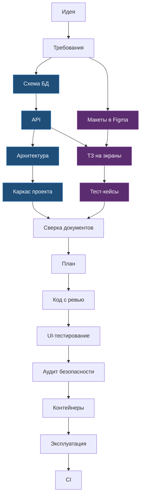
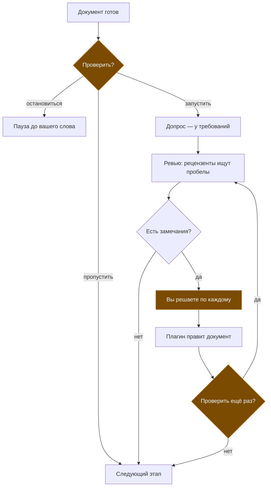
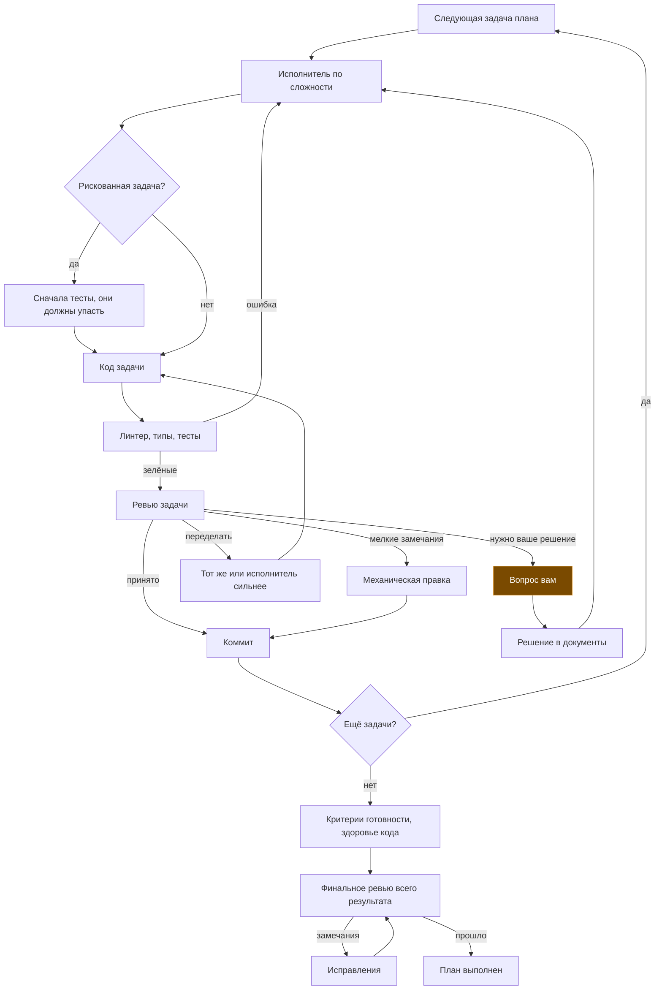
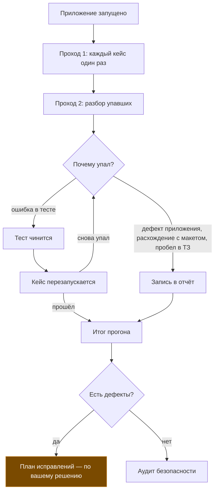

# dev-pipeline — от идеи до работающего сервиса вместе с Claude

Плагин для Claude Code, который проводит веб-сервис через все этапы разработки:

- требования;
- схема данных;
- API;
- архитектура;
- макеты в Figma;
- ТЗ на экраны;
- тест-кейсы;
- план;
- код с ревью;
- проверка через интерфейс;
- контейнеры и CI.

Вы принимаете решения — Claude делает работу и спрашивает на каждом шаге.

Версия плагина: **1.2.174**

---

<a id="как-устроен-процесс"></a>
<details>
<summary><h2>Как устроен процесс</h2></summary>



Синим — этапы бэкенда, фиолетовым — этапы дизайна.

| Этап | Что получается | Что делаете вы |
|---|---|---|
| Идея | бизнес-требования: цель, пользователи, границы | отвечаете на вопросы |
| Требования | SRS: требования, сценарии, правила, критерии приёмки | отвечаете, принимаете |
| Схема БД | таблицы, первая миграция, документ по каждой таблице с полями и связями | смотрите, задаёте вопросы |
| API | контракт API | — |
| Архитектура | основа, доменная модель, сценарии | выбираете стек из предложенных вариантов |
| Каркас проекта | пустой запускаемый проект с линтерами и проверками качества, карта проекта | — |
| Макеты в Figma | 2–3 визуальных направления образцами, экраны в выбранном; перекраска готовых | даёте ссылку на файл Figma, выбираете направление, смотрите макеты |
| ТЗ на экраны | ТЗ на фронтенд по каждому экрану | — |
| Тест-кейсы | пользовательские сценарии проверки, файл на раздел | — |
| Сверка документов | отчёт, согласованы ли все документы | решаете спорные места |
| План | работа, разбитая на небольшие задачи | подтверждаете номер версии, если он изменился |
| Код с ревью | код по плану и страница прогресса | следите за прогрессом |
| UI-тестирование | тест-кейсы прогнаны в браузере, отчёт о дефектах | следите за прогрессом прогона |
| Аудит безопасности | проверка всего приложения раз за итерацию: матрица доступа и находки | решаете по каждой серьёзной находке: исправить, принять риск или отложить |
| Контейнеры | образы, docker-compose, архив образов и инструкция по развёртыванию | — |
| Эксплуатация | что система записывает и где это смотреть; запросы проверены на стенде | смотрите пробелы: что видно только SQL-запросом |
| CI | проверки на каждый push (GitHub Actions; по запросу GitLab CI или CircleCI) | — |

Если у проекта нет интерфейса, плагин пропускает этапы дизайна, если нет базы данных — схему БД. Что и
почему пропущено, он скажет сам.

### Итерация

Итерация — один проход по этапам ради одной версии сервиса. У нового проекта первая версия `0.1.0`; у
доработки плагин предлагает следующий номер по тому, что меняется, и спрашивает. Рабочие файлы итерации
лежат в `documentation/plans/<версия>/` и в git не попадают.

Вся работа итерации идёт в одной ветке `iteration/<версия>`, поэтому в `main` всегда лежит последняя
законченная версия:

- плагин создаёт её от `main` в начале итерации, и все этапы делают коммиты в неё; в `main` за итерацию
  не попадает ничего;
- на GitHub отправляется только эта ветка: команду даёт плагин, запускаете её вы, и вы же сливаете ветку в
  `main`;
- следующая итерация начнётся от обновлённого `main`; если прошлая ветка ещё не слита, плагин предупредит.

### Исполнители и сложность

Работу на каждом этапе делают агенты-исполнители — отдельные копии модели, у каждой свои указания. Модель
подбирается под работу: где решать почти нечего, работает модель попроще и подешевле, где ошибка стоит дорого
— самая сильная. На трёх этапах плагин для этого сначала оценивает сложность работы, на остальных исполнитель
один.

| Этап | Как выбирается исполнитель | Модель |
|---|---|---|
| Требования | один исполнитель | Sonnet, high |
| Схема БД, API, архитектура | по сложности документа | низкая — Sonnet, high<br>средняя — Opus, high<br>высокая — Opus, xhigh |
| Макеты в Figma | по виду работы | новые экраны, редизайн, образцы направлений — Opus, high<br>правки и перекраска готовых экранов — Sonnet, medium |
| ТЗ на экраны | один исполнитель | Sonnet, high |
| Тест-кейсы | один исполнитель | Sonnet, medium |
| Сверка документов | один исполнитель | Sonnet, high |
| План | по сложности плана | низкая — Sonnet, high<br>средняя — Opus, high<br>высокая — Opus, xhigh |
| Код с ревью | по сложности каждой задачи | см. «Задачи кода» ниже |
| UI-тестирование | один исполнитель | Sonnet, high |
| Аудит безопасности | один исполнитель | Opus, high |

Решения в требованиях, документах и плане принимает исполнитель этапа, а в файл их печатает отдельный —
Sonnet, low: длинный текст по готовым решениям не требует сильной модели.

Проверки тоже распределены по моделям:

- ревью документа:
  - согласованность и выполнимость — Sonnet, medium;
  - язык проекта и объём — Sonnet, high;
  - замысел, безопасность и попытка опровергнуть документ — Opus, high;
- ревью плана:
  - структура — Sonnet, medium;
  - суждение о задачах — Opus, xhigh;
- ревью кода:
  - каждой задачи — по её сложности (ниже);
  - итоговое ревью всего результата — Opus, high.

**Что такое сложность.** Это не объём и не важность работы, а то, сколько решений остаётся исполнителю.
Длинный документ о простом CRUD — низкая сложность; короткий, где нужно решить, кто к чему получает доступ, —
высокая.

**Документы и план:**

- низкая — одна таблица, одна операция или простой CRUD, где решать нечего;
- средняя — обычная работа одной части системы, или документу предстоит решить вопрос доступа, денег или
  секретов;
- высокая — такой вопрос вместе с переделкой нескольких разделов, или большая связанная работа: много
  сценариев, таблиц и операций со своими правилами.

**Задачи кода.** Каждой задаче плана плагин ставит одну из четырёх сложностей:

| Сложность | Что это за задача | Исполнитель | Ревью задачи |
|---|---|---|---|
| Механическая | одна повторяемая правка: переименование, перенос, значение настройки, перегенерация — сколько бы файлов она ни задела | Haiku, low | отдельного нет: изменения смотрит сам плагин |
| Низкая | всё решено в документах, а в проекте есть похожий код: перенести решение в код | Sonnet, medium | одно ревью на пачку низких задач — Opus, high |
| Средняя | часть решений остаётся исполнителю или ошибка стоит дорого: принять оставшиеся решения и доказать их тестами | Sonnet, high | ревью задачи — Opus, high |
| Высокая | решение открыто, задача задевает несколько частей проекта или ошибку не исправить: спроектировать недостающее в заданных границах и проверить на крайних случаях | Sonnet, high | строгое ревью — Opus, xhigh — и отдельная проверка рисков |

Экраны по макетам при любой сложности пишет отдельный исполнитель для интерфейса — Sonnet, high; ревью — по
сложности задачи.

Сложность задачи плагин определяет по шести признакам:

- осталось ли что-то решать;
- насколько полно задача описана в документах;
- сколько частей проекта она задевает;
- есть ли в проекте похожий код, на который можно опереться;
- чем обойдётся ошибка;
- как доказать результат: прямой проверкой или только с подменой времени, одновременными запросами, сквозным
  прогоном.

Правила:

- задача не ниже средней, если ошибка в ней касается:
  - входа;
  - прав доступа;
  - денег;
  - миграций на существующих данных;
  - секретов;
  - или внешнего контракта;
- такая задача — высокая, если в ней ещё осталось решение или её доказывает только тест одновременных
  запросов (например, деньги списываются под блокировкой строки);
- три дорогих признака сразу — высокая, даже без риска;
- объём — не сложность: тридцать файлов одной правки — механическая задача.

**Если исполнитель не справился**, задача поднимается на уровень выше вместе с отчётом прошлой попытки:
механическая → низкая → средняя → высокая → последний уровень (Sonnet, high). На последнем уровне задача
повторяется, пока попытки что-то дают; потом плагин останавливается и спрашивает вас. Выше механического
уровня модель везде одна и та же: следующий уровень помогает не моделью посильнее, а своими указаниями и
отчётом прошлой попытки.

<!-- models -->
<!-- /models -->

### Проверки между этапами

Каждый этап опирается на результат предыдущего: код пишется по плану, план — по документам, документы — по
требованиям. Пробел, пропущенный в требованиях, потом обойдётся переделкой кода. Поэтому после этапов
плагин проверяет их результат, прежде чем идти дальше. Проверок пять:

- **Допрос** (`grill-me`) — плагин задаёт неудобные вопросы по требованиям, чтобы не осталось молчаливых
  допущений. На каждый вопрос отвечаете вы. Идёт после идеи и после требований. На первой
  версии его лучше не пропускать.
- **Ревью документа** (`doc-review`) — несколько «рецензентов» с разных сторон (логика, безопасность,
  выполнимость) ищут пробелы. Плагин показывает все замечания сразу и предлагает пройти их по одному —
  решение по каждому ваше. После правок плагин спрашивает, проверить ли ещё раз; кругов будет столько,
  сколько понадобится. Идёт после:
  - требований;
  - схемы БД;
  - API;
  - каждого документа архитектуры;
  - ТЗ на экраны.
- **Сверка документов** (`docs-consistency`) — отдельный этап перед планом: плагин читает все документы вместе
  и проверяет, что у каждого требования есть место в документах, а одно и то же везде называется одинаково.
- **Ревью плана** (`plan-review`) проверяет, что:
  - задачи действительно маленькие;
  - порядок верный;
  - каждый критерий приёмки чем-то покрыт.

  Замечания к плану плагин исправляет сам и проверяет снова, пока план не пройдёт.
- **Ревью кода** (`code-review-unit`, `code-review-full`) — проверяет каждую задачу сразу после неё и весь
  результат в конце.

Допрос, ревью документа и сверку плагин сначала предлагает, а вы выбираете:

- запустить;
- пропустить;
- или остановиться.

Ревью плана и ревью кода идут сами: к этому моменту продуктовые решения уже приняты в документах, и
найденное плагин исправляет сам. Если какого-то решения не хватает, он остановится и спросит.

Замечание, которое идёт против уже записанного решения (например, в требованиях сказано, что лимита запросов с
одного адреса нет), плагин сам не исправляет — ни в ревью, ни в аудите: он показывает это решение и спрашивает,
менять ли его.

Как идёт проверка документа:



Коричневым — шаги, где решаете вы.

Пропуск проверки — нормальный выбор для маленького изменения; плагин сам порекомендует, когда можно пропустить.

**Круги исправлений.** Если проверка что-то нашла, плагин исправляет и проверяет снова, пока проверка не
пройдёт; заранее заданного числа кругов нет. Новый круг запускают только блокирующие замечания, мелкие уходят
в отчёт. Если замечание осталось после исправления, за него берётся исполнитель следующего уровня. В файле
прогресса видно, как идут круги: «Круг 3: закрыто 2, осталось 1».

Плагин остановится и спросит вас:

- когда круги перестали давать результат:
  - вернулось уже исправленное замечание;
  - круг ничего не закрыл;
  - не справился исполнитель последнего уровня;
- или когда нужно ваше решение.

### Выполнение плана

Код пишет плагин (`work`) по готовому плану, задача за задачей.

Путь одной задачи:



Коричневым — шаг, где решаете вы.

**Выполнение идёт само:** ревью, исправления и повторные проверки идут без вопросов к вам. Плагин
останавливается и спрашивает, только когда задача не может пройти:

- в документах не хватает решения;
- ревью нашло ошибку в проектных документах, а не в коде;
- или круги исправлений перестали давать результат.

Тогда плагин напишет в чат:

- что мешает;
- что уже пробовали;
- что вы можете решить.

Ваше решение плагин сам вносит в документы и коммитит, прежде чем продолжить (см. «Решение поменялось по ходу
работы» в разделе [Доработка существующего проекта](#доработка-существующего-проекта)).

Прогон можно оставить на ночь: закончив задачу, плагин сразу берёт следующую и вашего ответа не ждёт.
Случайное или короткое сообщение («ну?», «ты тут?») прогон не останавливает: плагин ответит одной строкой со
счётом и ссылкой на прогресс и продолжит.

**Проверить, а не спросить.** Прежде чем спросить вас о чём-то внутри прогона, плагин смотрит, нельзя ли
узнать ответ, просто что-то запустив, например:

- какой порт у стенда;
- отдаёт ли API поле;
- проходит ли тест без правки;
- дефект это приложения или теста.

Такое он проверяет сам и пишет «решил по проверке: … → …». Спрашивает только о решениях: продукт, объём,
правило, которое документы оставили открытым. На этапах проектирования вопросы задаются намеренно, и это
правило их не касается.

#### Качество кода

Код пишут агенты, и качество держат не на словах:

- **Правила языка.** Каждый исполнитель получает правила своего языка и библиотек — `typescript`, `react`,
  `python` и скиллы библиотек. Плагин подбирает их по стеку проекта и файлам задачи.
- **Автоматические проверки** — после каждой задачи и в CI на каждый push; ошибка возвращает задачу
  исполнителю:
  - линтер с порогами сложности и размера функций и файлов;
  - запрет пустых `catch` и промисов, результат которых никто не проверяет;
  - проверка типов вместе с тестами;
  - границы слоёв;
  - мёртвый код и дубли.
- **Ревью задачи** смотрит то, чего машина не видит: правило, скопированное в другой слой вместо того, чтобы
  взять его из одного места, и ошибки, которые перехватываются и пропадают
  без записи в лог.
- **Тесты:**
  - правила, которые должны держаться на любых входах, проверяются на сотнях случайных значений;
  - тесты бизнес-правил — мутационной проверкой: программа нарочно ломает код и смотрит, заметят ли тесты;
  - защиту от двойного действия доказывает тест двух одновременных запросов к настоящей базе.
- **Сначала тесты** — для задач со входом, правами, деньгами, миграциями на существующих данных или
  секретами и для всех задач высшей сложности: исполнитель сначала пишет только тесты, плагин проверяет, что
  они падают по нужной причине, и только потом исполнитель пишет код.
- **Здоровье кода в конце прогона:** отдельный коммит убирает то, что разрослось за прогон, а итоговое ревью
  проверяет, что код не стал хуже.
- **Зависимости.** CI проверяет их на известные уязвимости отдельной задачей: сначала она только
  предупреждает, обязательной её делают разработчики проекта, когда готовы.

#### Долгий прогон: остановка, продолжение, сжатие контекста

Прогон можно остановить и продолжить без потерь:

- на «стоп», «подожди» или «остановись» прогон останавливается на безопасной границе: плагин сохраняет
  незаконченную работу и останавливает фоновые процессы, которые следят за стендом и тестами;
- если прогон прервался (обрыв связи или сжатие контекста — Claude Code сокращает длинную переписку до
  сводки), любое ваше сообщение возобновит его с того места, где
  он остановился;
- новая сессия ничего сделанного не переделывает и не повторяет уже провалившиеся попытки.

#### Стенд для проверок в браузере

Браузерным тестам в `work`, UI-тестированию и аудиту безопасности нужно запущенное приложение. Как его
поднять, плагин записывает в сам проект — скилл `.claude/skills/verify/`:

- команда запуска и что значит «готов»;
- вход под каждой ролью;
- тестовые данные;
- подвохи окружения.

Скилл пишет первый этап, которому нужен стенд, дальше плагин сам дополняет его. Так каждая следующая сессия
берёт готовое, а не выясняет заново.

### Прогресс долгих этапов

Каждый долгий этап ведёт файл прогресса со страницей, где видно, как идёт работа. У выполнения плана это
`documentation/plans/<версия>/progress.md` рядом с планом. В нём по каждой задаче:

- что делает;
- какой агент её выполняет;
- статус;
- итог ревью.

Строка меняется сразу, как только меняется статус задачи.

Статусы одни и те же во всех файлах прогресса — у задач, экранов, документов, сканеров, исправлений и
стендов:

| Статус | Значит |
|---|---|
| `⏳ ждёт` | ещё не начато |
| `🔄 в работе` | начато: отдано исполнителю, рисуется, пишется, выполняется, исправляется |
| `🔍 ревью`, `🔍 аудит`, `🔍 разбор`, `🔍 проверка` | сделано, идёт проверка — название говорит, какая |
| `✅ готово` | закончено и принято, полоса прогресса считает эти строки |
| `🔁 возвращено: <что>` | отправлено на доработку после проверки |
| `⛔ остановлено: <причина>` | дальше нельзя без решения или недостающего, или не удалось запустить |
| `⏭ пропущено: <почему>` | не нужно, вне объёма или ушло в отчёт |

После двоеточия этап может уточнить шаг (`🔄 в работе: печать`). Исключение одно — отчёт UI-тестирования:
там таблица — это отчёт о дефектах, и у кейса свои итоги (см. ниже).

**Как открыть:** в приложении Claude плагин сам открывает страницу прогресса этапа во встроенном браузере —
у выполнения плана это `progress.html` — и даёт ссылку на неё в чат. На странице:

- полоса прогресса;
- счёт;
- сколько строк в каждом статусе;
- таблица задач.

Страница обновляется сама каждые 5 секунд; её отдаёт локальный сервер, который виден только с вашего
компьютера. В терминальном Claude Code встроенного браузера нет: там ссылка ведёт на файл. Ссылка
повторяется после каждой задачи вместе со счётом — «План: 3 из 6 · progress.html» — и при каждой остановке.

Так выглядит страница прогресса:

Все задачи весят одинаково, процент округляется вниз, поэтому 100% появится только после последней задачи.

> **Прогресс выполнения плана — итерация 1.1.0**
>
> ```text
> ██████████████████████████████████████████████████░░░░░░░░░░░░░░░░░░░░░░░░░░░░░░░░░░░░░░░░░░░░░░░░░░ 50%
> ```
>
> Сделано: 3 из 6
>
> | U | Цель | Исполнитель | Статус | Ревью |
> |---|---|---|---|---|
> | U1 | миграция: таблица отмен брони | impl-lite | ✅ готово | COMMIT |
> | U2 | сущность «Бронь»: правило отмены не позже чем за час | impl-medium | ✅ готово | FIX_THEN_COMMIT (текст ошибки) → исправлено |
> | U3 | сценарий «Отменить бронь» | impl-medium | ✅ готово | COMMIT |
> | U4 | API: POST /bookings/{id}/cancel | impl-medium | 🔍 ревью | — |
> | U5 | экран S-2: кнопка «Отменить» и диалог подтверждения | impl-ui | 🔄 в работе | — |
> | U6 | версия сервиса 1.1.0 | mechanical-worker | ⏳ ждёт | — |
>
> Финальное ревью: не запускалось · BASE `a1b2c3d` · обновлено 2026-10-05 14:32

<details>
<summary><b>Другие долгие этапы</b></summary>

Другие долгие этапы ведут такой же файл в той же папке версии и так же дают в чат ссылку на его страницу:
перед первым шагом и потом после каждого пункта вместе со счётом («ТЗ на экраны: 5 из 10 ·
progress-screen-specs.html»).

| Этап | Файл | Одна строка — это |
|---|---|---|
| Макеты (`ui-design`): образцы направлений, рисование, перекраска | `progress-design.md` | экран или образец направления |
| ТЗ на экраны (`screen-spec`) | `progress-screen-specs.md` | экран |
| Тест-кейсы (`ui-test-cases`, write) | `progress-test-cases.md` | раздел тест-кейсов |
| Архитектура (`clean-architecture-design`) | `progress-architecture.md` | документ |
| Каркас проекта (`repo-scaffold`) | `progress-scaffold.md` | шаг |
| Аудит безопасности (`security-audit`) | `security-audit.md` | сканер или область приложения |
| Контейнеры (`deploy-topology`) | `progress-deploy.md` | шаг |
| UI-тестирование (`ui-test-cases`, run) | `test-run.md` | кейс |

Этапы, где плагин только задаёт вопросы (допрос требований, ревью документа), файла не ведут: прогресс
виден в самих вопросах — «Замечание 3 из 8».

</details>

### UI-тестирование

Тест-кейсы плагин пишет заранее, вместе с дизайном, а на этапе UI-тестирования прогоняет их на запущенном
приложении. `ui-test-cases` работает в двух режимах:

- **Запись** — после ТЗ на экраны: критерии приёмки из требований становятся пронумерованными кейсами с
  шагами и ожидаемыми текстами.
- **Прогон** — после этапа «Код с ревью»: кейсы превращаются в Playwright-тесты и прогоняются на запущенном
  приложении в два прохода — сначала весь набор, потом разбор упавших. Заодно экраны сверяются с макетами на
  каждой ширине из реестра макетов: страница не должна прокручиваться вбок (UX-74).

Как идёт прогон:



Коричневым — шаг, где решаете вы.

Дефекты плагин сам не исправляет: если вы решите, он составит по ним отдельный план.

<details>
<summary><b>Как выглядит тест-кейс</b></summary>

Кейс читает человек (тестировщик, аналитик, вы), а агент прогона превращает его в автотест. Поэтому у кейса два
слоя: тело — человеческим языком, всё техническое — в строке «Трассировка» под ним.

> **TC-7. Резидент не может отменить бронь, которая уже началась**
>
> **Проверяет:** UC-2 AC-Exc-2 · BR-4
> **Кто:** резидент · **Экран:** Расписание переговорных (S-2), окно «Отмена брони»
> **Подготовка:** резидент вошёл; у него бронь «Байкал», начавшаяся 10 минут назад
>
> | # | Действие | Что должно быть |
> |---|---|---|
> | 1 | Открыть расписание на сегодня | бронь «Байкал» отмечена как своя |
> | 2 | Выбрать свою бронь «Байкал» | открылось окно «Отмена брони» |
> | 3 | Выбрать «Отменить бронь» | в окне текст «Бронь уже началась, отменить нельзя»; в расписании бронь осталась |
>
> <sub>Трассировка: кадр 12:160 · шаг 2 → эл. 11; шаг 3 → эл. 3 (M2), `cancelBooking` → 409 BOOKING_STARTED</sub>

Шаги — действия по подписям, которые видны на экране; ожидаемое — то, что видно глазами, с точными
текстами и настоящими датами. Кадры, номера элементов, вызовы API и коды ответов — только в трассировке:
по ней агент находит элементы на странице, подменяет ответы
сервера и сверяет экран с макетом.

Если ТЗ на экран, макет или API поменялись, ссылки в трассировке кейсов перепроверяются; что можно,
плагин исправляет сам, а к вам попадает только то, чего больше нет (элемент, на который ссылается кейс,
удалён).

</details>

<details>
<summary><b>Прогон пользовательских тестов: два прохода, полосы, статусы</b></summary>

Перед стартом плагин даёт ссылку на страницу `test-run.html`, перед вторым проходом — ещё раз.

1. **Проход 1 — весь набор до 100%.** Каждый кейс пишется и прогоняется один раз: прошёл, не прошёл или
   заблокирован. Тесты в этом проходе плагин не чинит —
   сначала нужна полная картина. Если кейсы проверяются в
   нескольких режимах (например, два способа входа), каждая пара «кейс × режим» считается отдельно.
2. **Проход 2 — разбор упавших.** Каждый не прошедший кейс разбирается:
   - ошибка в тесте — плагин чинит тест и перезапускает кейс, круг за кругом, пока каждая починка что-то
     меняет;
   - дефект приложения, расхождение с макетом или пробел в ТЗ — записываются как есть.

**Главная полоса — доля успешных кейсов**, а не выполненных: полоса «выполнено 94%» при трети упавших
выглядела бы почти готовой. Кейсы, которые нельзя автоматизировать, в процент не входят: успешно 18 из 23 —
это 78%. Полоса растёт в первом проходе и после каждого круга перезапуска, когда исправленные тесты начинают
проходить. Под ней — «Проверено: 24 из 24 · успешно 18 · не прошли 4 · заблокировано 1 · не автоматизированы
1»; «не прошли» — только настоящие падения.

**Перезапуск — со своей полосой.** Пока кейсы перезапускаются, основная полоса стоит на месте, а у
перезапуска свой блок с полосой и итогом.

Итог («Verdict») появляется только после второго прохода: `PASS`, `DEFECTS` или `BLOCKED`.

> **Прогресс прогона по кейсам — итерация 1.1.0**
>
> ```text
> ██████████████████████████████████████████████████████████████████████████████░░░░░░░░░░░░░░░░░░░░░░ 78%
> ```
>
> Проверено: 24 из 24 · успешно 18 · не прошли 4 · заблокировано 1 · не автоматизированы 1
>
> | TC | Кейс | Статус | Файл теста / комментарий |
> |---|---|---|---|
> | TC-1 | Список комнат на сегодня | ✅ прошёл | rooms.spec.ts |
> | TC-6 | Бронь пересекается с чужой | ❌ не прошёл | bookings.spec.ts · кнопка «Забронировать» серая, по макету синяя · e2e/artifacts/TC-6.png |
> | TC-7 | Отмена начавшейся брони | ❌ не прошёл | bookings.spec.ts · «Ошибка 409» вместо «Бронь уже началась, отменить нельзя» · e2e/artifacts/TC-7.png |
> | TC-12 | Вход через SMS | ⛔ заблокирован: нет тестовой заглушки SMS | |
> | TC-19 | Ошибка при недоступном хранилище файлов | ⏭ не автоматизирован: остановка хранилища сломает общий стенд | вручную: остановить хранилище на отдельном стенде, загрузить файл |
>
> **Проход 2 — разбор упавших**
>
> ```text
> ████████████████████████████████████████░░░░░░░░░░░░░░░░░░░░░░░░░░░░░░░░░░░░░░░░░░░░░░░░░░░░░░░░░░░░ 40%
> ```
>
> Разобрано: 2 из 5 · тест исправлен 1 · дефект приложения 1
>
> | TC | Кейс | Итог прохода 1 | Разбор | Статус |
> |---|---|---|---|---|
> | TC-7 | Отмена начавшейся брони | ❌ не прошёл | приложение отвечает 409 без текста из ТЗ | ❌ дефект приложения |
> | TC-8 | Отмена за час до начала | ❌ не прошёл | локатор кнопки по тексту, а не по роли | ✅ тест исправлен, прошёл |
> | TC-6 | Бронь пересекается с чужой | ❌ не прошёл | — | 🔍 проверка |
> | TC-15 | Повторная отмена | ❌ не прошёл | | ⏳ ждёт |
>
> Verdict: идёт прогон · коммит `1a2b3c4` · обновлено 2026-10-05 18:04

**Статусы кейса.**

- Итог первого прохода:
  - `✅ прошёл`;
  - `❌ не прошёл`;
  - `⛔ заблокирован` (не хватает того, что можно добавить, например тестового входа);
  - или `⏭ не автоматизирован` (автотестом на общем стенде честно не проверить: нужен отказ хранилища,
    перезапуск с другой настройкой — такие кейсы перечисляются под итогом в списке «Проверить вручную» с
    шагами);
- Итог второго прохода:
  - `✅ тест исправлен, прошёл`;
  - `⛔ тест не удалось исправить`;
  - `❌ дефект приложения` (приложение расходится с ТЗ);
  - `🖼 расхождение с макетом` (экран не совпадает с макетом);
  - или `❓ пробел в ТЗ` (ТЗ этого не описывает).

Кейс, прошедший после починки теста, в таблице первого прохода становится
`✅ прошёл после исправления теста`.

**Параллельный прогон.** Тесты, которые делят один стенд, идут по одному. Если компьютер позволяет, плагин
поднимает несколько одинаковых стендов (не больше четырёх) и делит тесты между ними; если стенд проекта
ещё нельзя копировать, он перед прогоном предложит сделать это отдельным коммитом. В отчёте написано, сколько
стендов взято и что ограничило; после прогона они убираются, чужие окружения (`dev`, `demo`) не трогаются.

</details>

### Аудит безопасности

Ревью кода в `work` смотрят только то, что изменил очередной план. Раз за итерацию, перед сборкой релиза,
`security-audit` проверяет приложение целиком. Запустить его можно и в любой момент: «проверь безопасность».

1. **Сканеры по всему коду и всей истории git** (через Docker, ничего не ставится на компьютер):
   - уязвимые версии зависимостей (`osv-scanner`);
   - ключи и пароли в файлах и старых коммитах (`gitleaks`);
   - опасные шаблоны кода по OWASP (`semgrep`).
2. **Матрица доступа** из документов: каждая операция API — кто её может вызывать по требованиям и чьи
   данные она трогает.
3. **Проверка по областям**: агент на Opus проходит каждую операцию от входа запроса до базы
   данных:
   - проверяются ли права;
   - нельзя ли получить чужие данные, подменив id;
   - проверяется ли ввод;
   - не уходит ли лишнее в ответе и в ошибках.

   Отдельно проверяются настройки всего приложения: сессии, cookie, CORS, лимиты, конфигурация.
4. **Перепроверка**: второй проход пытается опровергнуть каждую серьёзную находку, и ложные
   срабатывания отсеиваются.

По каждой находке P0/P1 плагин спросит:

- исправить;
- принять риск (с вашей причиной);
- или отложить.

Исправления идут обычным планом и `work`, после них аудит перепроверяет только исправленное. Пока открыта
находка P0, этап «Контейнеры» не соберёт релиз, если вы не скажете «собирать всё равно». Сами Docker-образы
проверяются сканером `trivy` при сборке релиза. Сканеры качают базы уязвимостей из интернета; за
корпоративным прокси плагин берёт настройки прокси с машины, а если сеть недоступна, сканер помечается «не
запускался: сеть», и аудит идёт дальше.

### Эксплуатационная документация

`DEPLOY.md` говорит, как систему запустить. Что делать с ней потом, говорит
`documentation/operations/operations.md`:

- где посмотреть:
  - кто отменил бронь;
  - отработала ли ночная очистка;
  - почему не ушло письмо;
- что делать, когда растёт очередь.

Плагин пишет его после сборки образов и кладёт в релиз как `OPERATIONS.md` рядом с `DEPLOY.md`.

<details>
<summary><b>Что внутри документа</b></summary>

Документ один для двух читателей: тех, кто эксплуатирует систему, и разработчиков на дежурстве. В каждой
строке — задача человеческими словами и отдельным столбцом «Где в системе»: таблица, файл, операция API.
Разделы:

- доступы;
- журналы:
  - что в записи;
  - кто пишет;
  - сколько хранится;
  - как посмотреть;
- готовые SQL-запросы только для чтения;
- события в логах с фильтрами;
- проверки и метрики;
- фоновые процессы;
- тревоги;
- типовые операции;
- разбор проблем по симптомам.

Всё берётся из схемы, архитектуры, требований и кода — ничего не придумывается. Если журнал по требованиям
должен видеть администратор, а увидеть его можно только SQL-запросом, документ так и пишет: «только SQL —
экрана нет», и этот пробел попадает в отчёт этапа. Каждый запрос и каждую команду плагин прогоняет на тестовом
стенде на настоящих записях, а тест в проекте проверяет все запросы документа на тестовой базе: переименуют
колонку — упадёт сборка, а не дежурный ночью.

**Обязательные журналы.** Журналы, которые система обязана вести по закону, регламенту или требованиям
безопасности (обработка персональных данных, согласия, запросы субъектов, доступ к ПДн, аудит действий), идут
отдельным разделом «Обязательные журналы»:

- основание;
- срок хранения по основанию и в системе;
- кто может смотреть.

Если такой журнал требуется, а в системе его нет, или срок короче положенного, — это первая строка отчёта
этапа.

</details>

### Конец итерации

Когда пройден последний этап итерации (или последний из тех, что вы не пропустили), плагин закрывает её сам:

- пересобирает сайт документации;
- пишет итог версии `plans/<версия>/summary.md` — это и есть закрытие;
- ставит метку `v<версия>` в git — снимок документации и кода; с ним следующая итерация сравнивает,
  что изменилось;
- запускает разбор сессий для плагина (`/dev-pipeline:reflect`, см. ниже);
- убирает рабочие файлы закрытой итерации (см. ниже) и даёт команду, чтобы отправить ветку.

Если вы остановили работу раньше последнего этапа, а версию всё равно выпускаете, напишите «итог» — плагин
закроет итерацию так же.

**Уборка.** После итога плагин удаляет рабочие файлы закрытой итерации, чтобы не копить архив:

- план;
- ревью плана;
- файлы прогресса;
- отчёты прогонов и аудита;
- служебные файлы.

Остаётся только `summary.md` — цифры итерации. Документы проекта (требования, API, архитектура, ТЗ,
тест-кейсы) не трогаются. Перед удалением плагин переносит в документы то, что было записано только в
рабочих файлах, —
например, принятые риски из отчёта аудита уходят в решения архитектуры. Папка `plans/` не хранится в git,
удалённое не вернуть, поэтому плагин показывает список с размерами и спрашивает один раз. Лишние файлы в
`documentation/` — которых нет в реестре и на которые никто не ссылается — он только показывает и спрашивает
по каждому.

### Разбор сессий для плагина

В конце каждой итерации, без вопроса, плагин запускает `reflect`: перечитывает сессии этого проекта за
итерацию и записывает, где сработал не так сам плагин, а не проект. Например:

- вы поправляли этап («а где ссылка?», «прогресс не обновляется»);
- этап нарушил правило своего скилла;
- правило потерялось после сжатия контекста;
- сессия долго выясняла то, что должно быть в правилах.

Итог дописывается в `~/.claude/dev-pipeline-feedback/<проект>.md` — вне репозитория проекта, в git ничего
не попадает. У каждой находки ваши слова как доказательство, скилл и правило и что предлагается поменять.
Плагин сам себя не правит: файл читает тот, кто ведёт плагин. Запустить вручную в любой момент:
`/dev-pipeline:reflect` или «разбери сессии для плагина».

</details><!-- /раздел -->

---

<a id="результат-работы-плагина"></a>
<details>
<summary><h2>Результат работы плагина</h2></summary>

- **Комплект документации:**
  - требования (SRS);
  - схема базы данных;
  - контракт API;
  - архитектура;
  - макеты в Figma;
  - ТЗ на каждый экран;
  - пользовательские тест-кейсы.
- Документы пишутся в формате Markdown (`.md`) в папке `documentation/`.
- Из них плагин сам собирает статичный сайт `documentation/_web-docs/` с меню, поиском и ссылками между
  документами.
- Открыть сайт: `/dev-pipeline:open-docs` или просто «открой сайт документации».

  <details>
  <summary><b>Что есть на сайте и как он обновляется</b></summary>

  - по каждой таблице БД — своя страница: поля с типами, ключами, связями и описанием, входящие связи и что
    будет при удалении записи;
  - меню по разделам, длинные списки свёрнуты в группы со счётчиком;
  - номера требований, правил, сценариев, тест-кейсов и экранов — ссылки на место, где они определены; при
    наведении появляется их текст;
  - поиск по тексту и по номеру: «FR-12» сразу открывает требование;
  - схемы на своих местах;
  - контракт API — страницей в интерфейсе Swagger, работает без интернета;
  - журнал изменений каждого документа свёрнут;
  - светлая и тёмная тема, удобный вид на телефоне.

  Плагин собирает сайт, как только появляется первый документ, и пересобирает его после каждой правки.
  Сайт коммитится вместе с документами, поэтому тот, кто клонирует репозиторий, получает его без сборки.
  Без Claude его можно открыть файлом: `open documentation/_web-docs/index.html`. «Закрой сайт» останавливает
  локальный сервер, через который его показывает встроенный браузер. Публикуете сайт только вы сами;
  отказаться от него можно через `/dev-pipeline:upgrade-docs` («не нужно этому проекту»).

  </details>
- Структура папок:

  ```text
  documentation/
  ├── _web-docs/         сайт документации — собирается сам
  ├── requirements/      требования: бизнес-требования, SRS, пожелания к интерфейсу
  ├── db/                схема базы данных, миграции, страница на каждую таблицу
  ├── api/               OpenAPI-спецификация
  ├── architecture/      архитектура: основа, доменная модель, сценарии по областям
  ├── ui/                реестр макетов, ТЗ на экраны, тест-кейсы на пользовательские сценарии
  ├── project-map/       карта проекта: где какой документ и где код
  ├── deploy/            инструкция по запуску (deploy.md)
  └── operations/        эксплуатационная документация (operations.md)
  ```

- **Работающий код** — бэкенд и фронтенд.
- **Архитектура — модульный монолит:**
  - один бэкенд-сервис, разделённый на модули по областям; границы между модулями проверяет линтер;
  - отдельный фронтенд и база PostgreSQL.

  > Сервисная архитектура — разделение на отдельные сервисы — будет в будущих версиях плагина.

- **UI-тестирование** — Playwright-тесты по тест-кейсам, прогнанные на запущенном приложении.
- **Контейнеры и CI:**
  - docker-compose для тестов, разработки и продакшена;
  - папка выпуска `release/<версия>/` для эксплуатации:
    - архив образов;
    - `DEPLOY.md` — как запустить;
    - `OPERATIONS.md` — где что смотреть потом;
  - проверки на каждый push.

</details><!-- /раздел -->

---

<a id="что-нужно-подготовить"></a>
<details>
<summary><h2>Что нужно подготовить</h2></summary>

### 1. Figma — для макетов

Плагин рисует макеты экранов прямо в Figma, а потом пишет по ним ТЗ для фронтенда.

Нужен **платный аккаунт Figma** (Professional, Organization или Enterprise) с доступом **Full**. С доступом
**Dev** тоже получится, но файл для макетов должен лежать в разделе «Черновики» (Drafts) вашего Figma, а не
в проекте команды: файлы команды с доступом Dev открываются только для чтения.

Если у сервиса нет интерфейса, Figma не нужна — дизайн-этапы пропускаются.

### 2. MCP-серверы

| Сервер | Зачем | Что сделать |
|---|---|---|
| **Figma** | рисовать макеты, читать их для ТЗ и для проверки экранов | один раз войти в аккаунт — см. «Как подключить Figma» ([Что нужно подготовить](#что-нужно-подготовить)) |
| **Context7** | брать актуальную документацию библиотек, когда пишется код | ничего, работает сразу |

Без входа в Figma этапы с макетами остановятся и попросят подключить Figma.

#### Как подключить Figma

Делается один раз, после [установки плагина](#установка).

1. **Войдите в нужный аккаунт Figma в браузере** (figma.com). Подключится тот аккаунт, который сейчас открыт
   в браузере, — если у вас их несколько, сначала выйдите из лишнего.
2. **Откройте Claude Code** в терминале:

   ```bash
   claude
   ```

3. **Выполните команду** `/mcp`:

   ```text
   /mcp
   ```

   Откроется список подключений. Сервер Figma из плагина называется `plugin:dev-pipeline:figma` и
   помечен как требующий входа (`needs authentication`).
4. **Выберите его стрелками, нажмите Enter и выберите Authenticate.** Откроется браузер со страницей Figma.
   Если браузер не открылся, Claude Code покажет ссылку — скопируйте её и откройте вручную.
5. **На странице Figma нажмите Allow access** — так вы разрешаете Claude работать с вашими файлами.
6. **Вернитесь в терминал.** Появится сообщение `Authentication successful. Connected to figma`, а в
   списке `/mcp` у сервера будет статус `connected`. Список закрывается клавишей Esc.

### 3. Что нужно установить

| Программа | Зачем |
|---|---|
| **Claude Code 2.1.293+** | с этой версии механические задачи (переименования, значения настроек, мелкие исправления по ревью) выполняет быстрая и дешёвая модель Haiku 5.5; в старых версиях вместо неё запускается Haiku 4.5, которую на коде не проверяли. Версию покажет `claude --version`; приложение Claude обновляет её само |
| **Git** | история изменений, каждый шаг — коммит |
| **Python 3** | на нём работают хуки плагина: страницы прогресса, пересборка сайта документации и страниц таблиц БД, проверка проекта при старте сессии; ещё — поиск по базе стилей при выборе визуального направления |
| **D2** | схемы в документах (архитектура, схема БД) |
| **PlantUML** | диаграммы последовательности для сложных сценариев |
| **Node.js 22+** | проверка и разбивка контракта API, страница API на сайте документации; сервис на TypeScript; тесты через браузер |
| **uv** | зависимости сервиса — только если он на Python |
| **Docker** (Docker Desktop или Docker Engine) | локальная база данных, контейнеры, сборка образов, сканеры аудита |
| **Chromium для UI-тестов** (от Playwright) | браузер, в котором проходят UI-тесты |

Если D2 не установлен, документы всё равно пишутся, но вместо картинки схемы останется только её исходный
текст — плагин об этом скажет.

### 4. Установка программ по шагам

<details>
<summary><b>macOS</b></summary>

**Перед началом обновите macOS до 15 (Sequoia) или новее:** меню  → «Системные настройки» → «Основные» →
«Обновление ПО». На более старой macOS Homebrew не находит готовых программ и собирает их из исходного кода —
установка затягивается на часы.

**1. Homebrew** — менеджер программ для macOS. Вместе с ним ставятся инструменты разработчика Apple, а в них
уже есть Git и Python 3. Если Homebrew уже стоит (`brew --version` печатает версию), пропустите.

```bash
/bin/bash -c "$(curl -fsSL https://raw.githubusercontent.com/Homebrew/install/HEAD/install.sh)"
```

В конце установщик покажет две-три команды «Next steps» — выполните их, чтобы `brew` стал доступен.

**2. D2 и Node.js:**

```bash
brew install d2 node
```

**3. Docker Desktop:**

```bash
brew install --cask docker
```

Откройте Docker Desktop из «Программ» один раз и дождитесь, пока он запустится (значок кита в строке меню).

**4. uv** — только если сервис будет на Python:

```bash
brew install uv
```

**5. Chromium для UI-тестов:**

```bash
npx playwright install chromium
```

**6. PlantUML — не обязательно.** Без него плагин сам запускает PlantUML в Docker — тогда Docker должен
быть запущен на этапе архитектуры. Поставить, чтобы рисовать схемы без Docker:

```bash
brew install plantuml
```

</details>

<details>
<summary><b>Linux (Ubuntu, Debian)</b></summary>

Через `apt` ставятся только Git, curl и Python: D2 в стандартных репозиториях нет, а Docker и Node.js там
устаревших версий, поэтому для них — официальные способы установки.

**1. Git, curl, Python 3:**

```bash
sudo apt update && sudo apt install -y git curl python3
```

**2. D2:**

```bash
curl -fsSL https://d2lang.com/install.sh | sh -s --
```

**3. Docker Engine** (вместе с ним ставится buildx для сборки образов):

```bash
curl -fsSL https://get.docker.com | sh
```

Чтобы запускать Docker без `sudo`, добавьте себя в группу `docker`:

```bash
sudo usermod -aG docker $USER
```

Затем выйдите из системы и войдите снова (или перезагрузитесь), чтобы это вступило в силу.

**4. Node.js 22** — через nvm:

```bash
curl -o- https://raw.githubusercontent.com/nvm-sh/nvm/v0.40.8/install.sh | bash
```

Откройте новое окно терминала и поставьте Node.js:

```bash
nvm install 22
```

**5. Python и uv** — только если сервис будет на Python:

```bash
curl -LsSf https://astral.sh/uv/install.sh | sh
```

**6. Chromium для UI-тестов** (вместе с системными библиотеками, которые ему нужны):

```bash
npx playwright install --with-deps chromium
```

**7. PlantUML — не обязательно.** Без него плагин сам запускает PlantUML в Docker — тогда Docker должен
быть запущен на этапе архитектуры. Поставить, чтобы рисовать схемы без Docker:

```bash
sudo apt install -y plantuml
```

На Fedora и Arch вместо шага 1 — `sudo dnf install git curl python3` или `sudo pacman -S git curl python`;
остальные шаги те же.

</details>

<details>
<summary><b>Windows (через WSL 2)</b></summary>

Плагин работает в Linux-окружении внутри Windows — WSL 2 с Ubuntu. Все программы ставятся в Ubuntu,
а Docker — как Docker Desktop для Windows, который отдаёт Docker в Ubuntu.

Нужна Windows 11 или Windows 10 версии 2004 и новее (узнать: Win+R → `winver`). В BIOS/UEFI должна быть
включена виртуализация (Intel VT-x или AMD-V) — на большинстве компьютеров она включена; проверить:
Диспетчер задач → Производительность → ЦП → «Виртуализация: Включено».

**1. WSL 2 и Ubuntu.** Откройте PowerShell от имени администратора (Пуск → PowerShell → правой кнопкой →
«Запуск от имени администратора») и выполните:

```powershell
wsl --install
```

Перезагрузите компьютер. После перезагрузки откроется окно Ubuntu (если не открылось — найдите Ubuntu в
меню Пуск). Придумайте имя пользователя и пароль для Linux: они не связаны с учётной записью Windows,
пароль понадобится для команд с `sudo`.

Если WSL уже стоял, обновите его и проверьте, что Ubuntu работает на версии 2:

```powershell
wsl --update
```

```powershell
wsl -l -v
```

В колонке VERSION должно быть `2`. Если там `1`:

```powershell
wsl --set-version Ubuntu 2
```

**2. Docker Desktop для Windows** — ставится в Windows, не в Ubuntu. Скачайте
[Docker Desktop](https://docs.docker.com/desktop/setup/install/windows-install/) или в PowerShell:

```powershell
winget install -e --id Docker.DockerDesktop
```

Запустите Docker Desktop и в его настройках проверьте:
- Settings → General → включено «Use the WSL 2 based engine»;
- Settings → Resources → WSL integration → включён переключатель напротив Ubuntu → Apply & restart.

Docker Desktop должен быть запущен, когда плагин собирает образы или поднимает контейнеры.

Дальше всё — в окне Ubuntu (Пуск → Ubuntu, или вкладка Ubuntu в Windows Terminal).

**3. Git, curl, Python 3:**

```bash
sudo apt update && sudo apt install -y git curl python3
```

**4. D2:**

```bash
curl -fsSL https://d2lang.com/install.sh | sh -s --
```

**5. Node.js 22** — через nvm:

```bash
curl -o- https://raw.githubusercontent.com/nvm-sh/nvm/v0.40.8/install.sh | bash
```

Закройте и снова откройте окно Ubuntu и поставьте Node.js:

```bash
nvm install 22
```

Проверьте, что используется Node.js из Ubuntu, а не из Windows — путь должен начинаться с `/home/`:

```bash
which node
```

**6. Python и uv** — только если сервис будет на Python:

```bash
curl -LsSf https://astral.sh/uv/install.sh | sh
```

**7. Chromium для UI-тестов** (вместе с системными библиотеками, которые ему нужны):

```bash
npx playwright install --with-deps chromium
```

**8. PlantUML — не обязательно.** Без него плагин сам запускает PlantUML в Docker — тогда Docker должен
быть запущен на этапе архитектуры. Поставить, чтобы рисовать схемы без Docker:

```bash
sudo apt install -y plantuml
```

**9. Папка для проектов.** Держите проекты внутри Ubuntu, а не на диске `C:` (`/mnt/c/...`): там работа с
файлами в разы медленнее, и сборка с тестами заметно тормозит.

```bash
mkdir -p ~/projects && cd ~/projects
```

Открыть эту папку в Проводнике Windows можно командой `explorer.exe .`, а в VS Code (с расширением WSL) —
`code .`.

</details>

<details>
<summary><b>Проверка установки</b></summary>

```bash
git --version
```

```bash
d2 --version
```

```bash
docker --version
```

```bash
docker buildx version
```

```bash
node --version
```

```bash
python3 --version
```

Если какая-то пишет «command not found» — эта программа не поставилась или терминал нужно открыть заново.

</details>

</details><!-- /раздел -->

---

<a id="установка"></a>
<details>
<summary><h2>Установка</h2></summary>

В Claude Code (в чате) выполните две команды:

```text
/plugin marketplace add Idontlikedrinkpivo/web-dev-pipeline-claude-plugin
```

```text
/plugin install dev-pipeline@dev-pipeline-marketplace
```

Или то же самое в терминале:

```bash
claude plugin marketplace add Idontlikedrinkpivo/web-dev-pipeline-claude-plugin
```

```bash
claude plugin install dev-pipeline@dev-pipeline-marketplace
```

Затем:

1. **Перезапустите Claude Code** — так он увидит скиллы и агентов плагина.
2. **Подключите Figma** — по шагам «Как подключить Figma» в разделе [Что нужно подготовить](#что-нужно-подготовить).

### Обновление до новой версии

Номер последней версии указан в начале этого README («Версия плагина»).

В Claude Code (в чате):

1. **Узнайте, какая версия стоит у вас:**

   ```text
   /plugin list
   ```

2. **Обновите плагин.** Команда откроет вкладку Marketplaces — выберите в ней `dev-pipeline-marketplace` и
   пункт **Update marketplace**:

   ```text
   /plugin marketplace update dev-pipeline-marketplace
   ```

3. **Включите новую версию в открытой сессии** (в новых сессиях она работает сразу):

   ```text
   /reload-plugins
   ```

Или то же самое в терминале, после чего перезапустите Claude Code:

```bash
claude plugin marketplace update dev-pipeline-marketplace
```

```bash
claude plugin update dev-pipeline@dev-pipeline-marketplace
```

**Чтобы обновления приходили сами:** `/plugin` → вкладка Marketplaces → `dev-pipeline-marketplace` →
**Enable auto-update**. Claude Code будет сам проверять новые версии после начала сессии.

**Проекты после обновления.** Новая версия иногда меняет, какими должны быть файлы проекта. Изменения бывают
двух видов, и у каждого своя команда:

- **Документы** — `/dev-pipeline:upgrade-docs`:
  - появляется новый документ;
  - новый раздел в нём;
  - новое правило для текста, который плагин уже написал.
- **Код и настройки проекта** — `/dev-pipeline:upgrade-code`:
  - автоматические проверки качества кода;
  - скилл запуска стенда;
  - подключение плагина для всех, кто открывает репозиторий.

Команды разделены, потому что документы правит аналитик и правка ничего не ломает, а изменение кода лучше
отдать разработчику: плагин прогоняет проверки проекта до и после каждого изменения, и поведение приложения
не меняется.

В начале сессии плагин одной строкой скажет, каких изменений в проекте ещё нет и какой командой их сделать.
Каждая команда объясняет свои изменения и по каждому спрашивает:

- сделать сейчас;
- не нужно этому проекту;
- или позже.

Выбранное делается по коммиту на изменение: в ветке открытой итерации, если она идёт, иначе в отдельной ветке
— `docs/plugin-<версия>` для документов, `chore/plugin-<версия>` для кода. Версию плагина команда записывает
в `documentation/.dev-pipeline.json`, когда изменений «на потом» не осталось ни у одной из двух. Без вашего
ответа ничего не меняется.

</details><!-- /раздел -->

---

<a id="быстрый-старт-новый-проект"></a>
<details>
<summary><h2>Быстрый старт: новый проект</h2></summary>

1. Создайте пустую папку для проекта и откройте её в Claude Code.
2. Опишите идею. Подходит любой формат — пара абзацев, заметка, тикет, письмо заказчика:

   ```text
   /dev-pipeline:brainstorm Хочу сервис бронирования переговорных для коворкинга.
   Резиденты бронируют комнату на время, администратор закрывает комнату на обслуживание.
   ```

3. Отвечайте на вопросы. Claude задаёт их по одному и предлагает варианты с рекомендацией.
4. После каждого этапа Claude показывает результат и спрашивает, что дальше:
   - **запустить** следующий этап;
   - или **остановиться**.

**Вернуться к проекту позже.** Остановиться можно в любой момент. В новой сессии напишите
`/dev-pipeline:continue` — плагин по файлам на диске поймёт, где вы остановились, и предложит следующий шаг.

</details><!-- /раздел -->

---

<a id="доработка-существующего-проекта"></a>
<details>
<summary><h2>Доработка существующего проекта</h2></summary>

Когда сервис уже есть, новая фича идёт тем же путём, но документы не пишутся заново — правятся на месте.
Начинайте с идеи, как и в первый раз:

```text
/dev-pipeline:brainstorm Добавить отмену брони: резидент может отменить свою бронь не позже чем за час.
```

`brainstorm` дополнит существующие бизнес-требования (новые пункты получают следующие свободные номера)
и уточнит то, что в идее не сказано:

- кто ещё может отменять;
- что происходит с отменённой бронью;
- кого уведомить.

Если идея уже описана точно — с критериями приёмки и границами, — он сам это заметит,
обойдётся парой вопросов и предложит перейти к требованиям.

Дальше плагин ведёт по тем же этапам и затрагивает только то, что меняется: каждое изменение в документе
помечается как «ломает», «добавляет» или «уточняет», и следующие этапы предлагаются только для тех
документов, которых оно касается.

### Новый вид интерфейса без новых функций

Требования не меняются, начинайте прямо с макетов:

```text
/dev-pipeline:ui-design Новое визуальное направление для всего интерфейса.
```

`ui-design` предложит 2–3 направления (цвета, шрифт, скругления, плотность) — образцы появятся на
странице «🎨 Направления» в Figma, вы выберете. Затем спросит, как применить выбранное:

- **перекрасить** — те же макеты, меняется только вид: структура экранов, тексты и номера кадров
  остаются, прежний вид сохраняется в архиве файла. Если экраны уже сделаны в коде, следующим будет
  план с задачей на тему оформления — экраны подхватят её без переделки;
- **нарисовать заново на отдельной странице** — все экраны рисуются заново в новом направлении,
  прежние макеты остаются рядом нетронутыми. Потом обновляются ТЗ на экраны (у новых кадров новые
  номера) и тест-кейсы, затем план.

Если какой-то экран нужно перестроить, а не только перекрасить, это редизайн: он идёт через ТЗ на
экран, как новый.

### Решение поменялось по ходу работы

Бывает, что решение меняется уже после того, как документ с ним написан:
- вы ответили на остановку в `work`;
- передумали посреди прогона («давай по-другому»);
- при просмотре макетов сказали «убери это поле»;
- прогон тестов показал, что неверно ТЗ, а не код;
- оказалось, что библиотека не умеет так, как записано.

Напоминать про документацию не нужно — плагин сам:

1. записывает изменение в раздел «Изменённые решения» — в отчёте и файле прогресса;
2. находит документ, которому решение принадлежит (требования, API, схема БД, архитектура, ТЗ на экран,
   тест-кейсы), и все документы, которые его повторяют, и правит их на месте;
3. сразу коммитит эти правки отдельным коммитом `docs: решение изменено — …`, **не меняя версию**:
   номер версии и строки журнала появятся при следующей простановке версий, и туда попадут все такие
   изменения;
4. продолжает работу уже по новому тексту. Код, который успели написать по старому решению, переделывается
   отдельным коммитом, а финальное ревью проверяет, что ни одно решение не осталось только в коде.

Если правка требует нового проектирования (например, меняется весь ход сценария), плагин остановится и
предложит запустить нужный этап.

</details><!-- /раздел -->

---

<a id="перечень-скиллов"></a>
<details>
<summary><h2>Перечень скиллов</h2></summary>

В плагине 46 скиллов. Сами вы обычно вызываете только `brainstorm` в начале и `continue`, когда возвращаетесь к
проекту, — дальше плагин ведёт сам.

**Начать и продолжить**

| Скилл | Что делает | Запуск |
|---|---|---|
| `/dev-pipeline:brainstorm` | разбирает сырую идею и пишет бизнес-требования | вручную |
| `/dev-pipeline:continue` | показывает, где вы остановились, и предлагает следующий шаг | вручную |

**Этапы — в порядке пайплайна**

| Скилл | Что делает | Запуск |
|---|---|---|
| `/dev-pipeline:srs-writer` | пишет или дополняет требования к системе (SRS) | плагин предлагает, вы подтверждаете |
| `/dev-pipeline:db-schema-design` | проектирует базу данных: таблицы, связи, миграции; документ на каждую таблицу | плагин предлагает, вы подтверждаете |
| `/dev-pipeline:openapi-spec-generator` | описывает API: все запросы к сервису и ответы на них (OpenAPI) | плагин предлагает, вы подтверждаете |
| `/dev-pipeline:clean-architecture-design` | проектирует архитектуру: стек, модули, бизнес-правила и сценарии | плагин предлагает, вы подтверждаете |
| `/dev-pipeline:repo-scaffold` | создаёт каркас проекта: папки, настройки, проверки качества кода | плагин предлагает, вы подтверждаете |
| `/dev-pipeline:ui-design` | рисует макеты экранов в Figma | плагин предлагает, вы подтверждаете |
| `/dev-pipeline:screen-spec` | пишет ТЗ на каждый экран для фронтенда | плагин предлагает, вы подтверждаете |
| `/dev-pipeline:ui-test-cases` | пишет пользовательские тест-кейсы и прогоняет их на готовом приложении | плагин предлагает, вы подтверждаете |
| `/dev-pipeline:docs-consistency` | проверяет, что документы не противоречат друг другу | плагин предлагает, вы подтверждаете |
| `/dev-pipeline:plan` | разбивает работу на небольшие задачи | плагин предлагает, вы подтверждаете |
| `/dev-pipeline:work` | выполняет план: пишет код, проверяет каждую задачу и коммитит | плагин предлагает, вы подтверждаете |
| `/dev-pipeline:security-audit` | проверяет безопасность всего приложения перед выпуском | плагин предлагает, вы подтверждаете |
| `/dev-pipeline:deploy-topology` | упаковывает приложение в контейнеры Docker и пишет инструкцию по запуску `DEPLOY.md` | плагин предлагает, вы подтверждаете |
| `/dev-pipeline:operations-doc` | пишет инструкцию для эксплуатации `OPERATIONS.md`: где смотреть журналы и что делать при сбоях | плагин предлагает, вы подтверждаете |
| `/dev-pipeline:ci-pipeline` | настраивает автоматические проверки кода при каждой отправке в GitHub (или GitLab, CircleCI) | плагин предлагает, вы подтверждаете |

**Проверки**

| Скилл | Что делает | Запуск |
|---|---|---|
| `/dev-pipeline:grill-me` | задаёт неудобные вопросы по документу, чтобы не осталось скрытых допущений | плагин предлагает, вы подтверждаете |
| `/dev-pipeline:doc-review` | проверяет документ глазами нескольких рецензентов | плагин предлагает, вы подтверждаете |
| `/dev-pipeline:plan-review` | проверяет план: размер и порядок задач, покрытие требований | автоматически после плана |
| `/dev-pipeline:code-review-unit` | проверяет код каждой задачи перед коммитом | автоматически внутри `work` |
| `/dev-pipeline:code-review-full` | проверяет весь результат после последней задачи | автоматически внутри `work` |

**Документация и обслуживание**

| Скилл | Что делает | Запуск |
|---|---|---|
| `/dev-pipeline:docs-site` | собирает из документов сайт с меню, поиском и ссылками | автоматически с первого документа |
| `/dev-pipeline:open-docs` | открывает сайт документации и даёт ссылку на него | вручную |
| `/dev-pipeline:upgrade-docs` | приводит документы проекта к новой версии плагина | после обновления плагин предлагает, вы подтверждаете |
| `/dev-pipeline:upgrade-code` | приводит код и настройки проекта к новой версии плагина: проверки качества, скилл запуска стенда | после обновления плагин предлагает, вы подтверждаете |
| `/dev-pipeline:doc-versioning` | ведёт версии документов и журнал изменений, находит устаревшие отсылки между ними | автоматически в конце этапа |
| `/dev-pipeline:pipeline` | ведёт по этапам: после каждого предлагает следующий, в конце закрывает версию | автоматически |
| `/dev-pipeline:reflect` | находит в сессиях, где плагин сработал плохо, и записывает это для автора плагина | автоматически в конце итерации |
| `/dev-pipeline:executor-catalog` | распределяет работу между моделями и агентами | автоматически |

**Дизайн**

| Скилл | Что делает | Запуск |
|---|---|---|
| `/dev-pipeline:ux-patterns` | задаёт правила удобства интерфейса для макетов и экранов | автоматически |
| `/dev-pipeline:ui-ux-pro-max` | подбирает стиль, палитру и шрифты для макетов | автоматически |
| `/dev-pipeline:frontend-design` | помогает сделать макеты не шаблонными | автоматически |
| `/dev-pipeline:web-design-guidelines` | задаёт правила интерфейса в коде: доступность, фокус, формы, тексты | автоматически |

**Правила для кода по технологиям** — их читают агенты, которые пишут и проверяют код

| Скилл | Что делает | Запуск |
|---|---|---|
| `/dev-pipeline:typescript` | задаёт правила кода на TypeScript | автоматически |
| `/dev-pipeline:react` | задаёт правила кода на React | автоматически |
| `/dev-pipeline:python` | задаёт правила кода на Python | автоматически |
| `/dev-pipeline:typescript-fastify` | задаёт правила серверной части на Fastify | автоматически |
| `/dev-pipeline:typescript-drizzle-orm` | задаёт правила работы с базой данных через Drizzle | автоматически |
| `/dev-pipeline:zod-skill` | задаёт правила проверки входных данных через Zod | автоматически |
| `/dev-pipeline:vitest` | задаёт правила тестов на Vitest | автоматически |
| `/dev-pipeline:fastapi` | задаёт правила серверной части на FastAPI | автоматически |
| `/dev-pipeline:fastapi-sqlalchemy` | задаёт правила работы с базой данных через SQLAlchemy | автоматически |
| `/dev-pipeline:pytest-patterns` | задаёт правила тестов на pytest | автоматически |
| `/dev-pipeline:frontend` | пишет экраны по ТЗ на React или Next.js | автоматически |
| `/dev-pipeline:playwright-cli` | управляет браузером и пишет тесты на Playwright, которые проходят приложение как пользователь | автоматически |

</details><!-- /раздел -->

---

<a id="ограничения"></a>
<details>
<summary><h2>Ограничения</h2></summary>

Плагин пишет код на этом стеке:

| Часть | Технологии |
|---|---|
| Бэкенд на TypeScript | Fastify, Drizzle, Zod, Vitest |
| Бэкенд на Python | FastAPI, SQLAlchemy, pytest |
| База данных | PostgreSQL |
| Фронтенд | React + Vite или Next.js на TypeScript |
| Данные и формы на фронтенде | TanStack Query, React Hook Form и Zod |
| Внешний вид | Tailwind CSS и shadcn/ui |
| Тесты фронтенда | Vitest и Testing Library, Playwright |

Другие технологии — только если они уже есть в проекте.

</details><!-- /раздел -->

---

<a id="благодарности"></a>
<details>
<summary><h2>Благодарности</h2></summary>

Часть скиллов плагина основана на существующих решениях:

| Скилл плагина | Основа | Автор | Лицензия |
|---|---|---|---|
| `ui-ux-pro-max` | [UI UX Pro Max](https://github.com/nextlevelbuilder/ui-ux-pro-max-skill) | Next Level Builder | MIT |
| `frontend-design` | [frontend-design](https://github.com/anthropics/skills) | Anthropic | Apache 2.0 |
| `web-design-guidelines` | [Web Interface Guidelines](https://github.com/vercel-labs/web-interface-guidelines) | Vercel Labs | MIT |
| `zod-skill` | [zod-skill](https://github.com/anivar/zod-skill) | Anivar Aravind | MIT |
| `fastapi` | [скилл FastAPI](https://github.com/fastapi/fastapi) | Sebastián Ramírez | MIT |
| `playwright-cli` | [playwright-cli](https://github.com/microsoft/playwright-cli) | Microsoft | Apache 2.0 |
| `pipeline` — продолжение прерванного прогона, «проверить, а не спросить», проверка допущения; `deploy-topology` — скилл запуска стенда | [pstack](https://github.com/cursor/plugins/tree/main/pstack) | Lauren Tan | MIT |
| `reflect` | [pstack](https://github.com/cursor/plugins/tree/main/pstack) | Lauren Tan | MIT |

</details><!-- /раздел -->

---

<a id="лицензия"></a>
<details>
<summary><h2>Лицензия</h2></summary>

[MIT](LICENSE) — можно свободно использовать, менять и распространять, сохраняя упоминание автора.

</details><!-- /раздел -->
